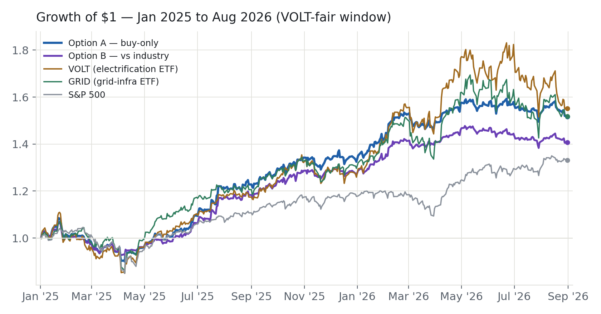
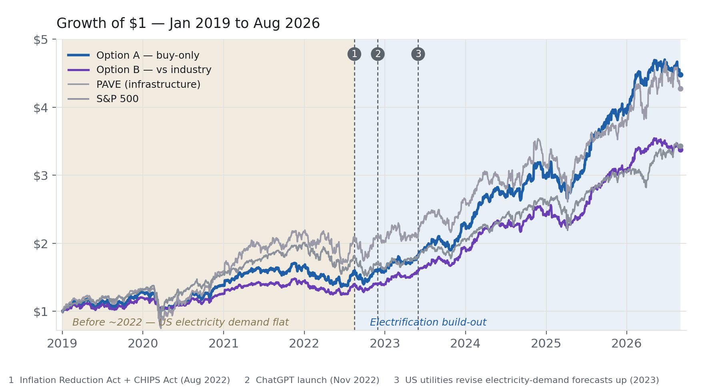
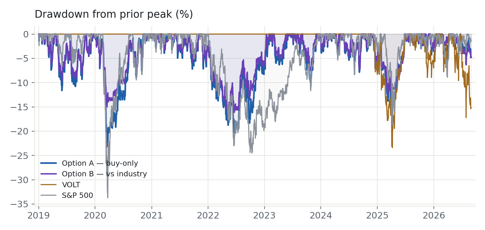
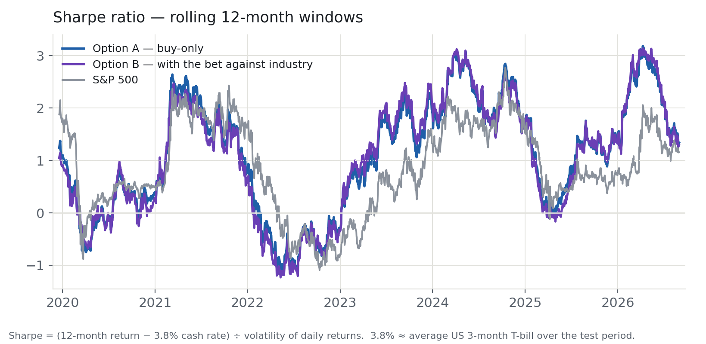

<!--
  Turn this file into HTML / PDF with tools/md2html.py (from the repo root):

    poetry run python tools/md2html.py docs/electrification-strategy-proposal-v6.md --theme light --pdf

  Options:  --theme auto | dark      --no-toggle      --toc      -o PATH
  Figures (docs/pv3-*.png) are inlined, so the HTML and PDF are self-contained.
-->

# Screened Electrification Equipment — Phase 2 Findings

## Summary

Building and upgrading the electricity network is a long-running
trend that is likely to continue for years as it rests on physical need  (to power AI data centres, to electrify heating, supply electric vehicles, and to bring factories back to the United States) rather than investor enthusiasm.

This strategy buys shares in the profitable,
well-run companies that make the equipment and do the construction work for that build-out.
It follows a fixed set of rules rather than a manager's judgement, and it has produced a
better balance of return and risk than simply buying an index fund for the same trend.

There are two versions:

- **Option A — buy-only.** The portfolio only buys shares; it never places bets that a
  price will fall (and pays no borrowing cost). It still moves a fair amount with the
  overall stock market: (about 0.6 as much as the market) but this is far less than the VOLT electrification index fund which has about 1.0 beta to market.
- **Option B — buy the suppliers, bet against general industry.** For a lower market beta, on top of Option A, add
  a position that profits if a broad basket of US industrial companies falls. This is a
  bet that the chosen electrical-equipment suppliers do better than industry as a whole.
  It cuts how much the portfolio moves with the market roughly in half — to about 0.37 —
  but it adds the fees and risks of betting against shares.

This is the Phase 2 findings report. It sits on top of the Phase 1 proposal (v5, unchanged
below) and adds six pieces of work commissioned for Phase 2: a formal test of whether the
strategy's sensitivity to grid stress can be turned into its own trading signal, a first look
at the trading cost of the short leg, a client risk-factor adapter built ahead of receiving
Addenda's own risk model, current market evidence for the physical-need thesis above, a test
of adding two data-centre-exposed REITs to the buy list, and an updated account of what
changed. None of this changes the buy list or the rules described above — those are still
exactly what was proposed in Phase 1. It is additional testing, diagnostics, and evidence
gathered on top.

---

## What the strategy buys

In this small test case, the portfolio holds roughly 27 companies that sell into the electricity build-out:
makers of power equipment (transformers, switchgear, the electronics that control power
flow), companies that build large batteries for the grid, and electrical engineering and
construction firms. It holds suppliers — not the utilities that run the wires, and not
the companies that own power plants.

A company is included only if:

1. it sells mainly to large institutional buyers — utilities, cloud-computing companies,
   industrial customers — not to consumers; and
2. it meets at least two of these three tests:
    - it makes a profit today,
    - its share price is set by its earnings (a reasonable P/E ratio) rather than by a story about the future, and
    - it does not depend heavily on government subsidies.

For the simple example, every holding gets the same weight, capped at 25% each.

---

## Built-in protections

Three rules adjust the portfolio automatically. Each one addresses a specific risk.

**Growth Scare, Rates Shock, Currency Shock, Geopolitical Risk** A 15% reserve is held in gold and short-term US government bonds.
If there is a scare about economic growth or company debt, the bond part of the sleeve will rise providing some protection. If
there is a currency or geopolitical shock, the gold rises. Either way, that portion holds
its value while shares fall.

**Prices get too far ahead of profits.**
If the holdings have risen well above their own long-term trend (prices too far ahead of profits) and well above the wider
market, the strategy sells some of them in steps — down to about 80% invested, then about
60%. This takes money off the table when prices look stretched, so the portfolio is not
fully exposed at a peak.

**Choppy Markets**
When day-to-day price swings grow, the strategy moves part of the money to cash; when
markets calm down, it moves back in. The aim is to keep the yearly size of the ups and
downs near 20%.

---

## How it compares to the VOLT electrification index fund

The strategy covers the same trend as VOLT, a listed index fund for electrification. It is
different in that it **leaves out the parts of VOLT that hold the return back**: regulated
electric utilities (about 30% of VOLT), oil and gas pipelines (about 10%), and basic
components (about 13%). Those businesses are sensitive to interest rates, grow slowly, and
are only loosely connected to the equipment build-out.

Over VOLT's live history (January 2025 to August 2026) the strategy delivered a **similar
total gain** (about +30%) but with a **better Sharpe** (1.49 versus 1.05), a
**smaller worst fall** (−17% versus −23%), and **less movement with the market** (about
0.6 beta versus about 1.0).

---

## Performance

*January 2025 to August 2026. The strategy keeps pace with the electrification index funds
but with much smaller swings — it does not jump to VOLT's 1.8-times level in mid-2026, and
it does not give that back afterwards.*

*January 2019 to August 2026. The strategy lagged from 2019 to 2022.  But since the electrification phase of the economy began, the strategy has outperformed to finish level with the infrastructure index fund and ahead of
the overall market — with smaller swings and a smaller drawdown than either.*

*The fall from each prior high point. In the 2020 COVID crash the strategy fell 22% while
the market fell 34%. In the 2022 interest-rate shock it fell 20% versus the market's 24%.
Its worst point in the whole test period is −23%.*

*Sharpe ratio over each rolling 12-month window — same 3.8% risk-free rate as the tables.
Both the strategy and the
market went negative in 2022; the strategy is ahead of the market for most of the record.*

### Return and risk by period

Four summary measures, each for three time spans. Sharpe (with risk free at avg 3m Tsy over the test period), Max Drawdown, Compound Annual Growth Rate, and market sensitivity measured as beta to S&P500.

*Full history · January 2019 – August 2026*

| Strategy | Sharpe | Max DD | CAGR | S&P Beta |
|---|--:|--:|--:|--:|
| **Option A** — buy-only | **1.05** | −23% | +20.8% | 0.61 |
| **Option B** — with the bet against industry | 1.02 | **−16%** | +16.6% | **0.37** |
| VOLT electrification index fund | — | — | — | — |
| VOLT + 15% gold/bond reserve | — | — | — | — |
| VOLT + 15% reserve + vol-target | — | — | — | — |
| US stock market (S&P 500) | 0.71 | −34% | +17.5% | 1.00 |
| S&P 500 + the 15% gold/bond reserve | 0.75 | −29% | +15.9% | 0.86 |

*AI-boom period · January 2023 – August 2026*

| Strategy | Sharpe | Max DD | CAGR | S&P Beta |
|---|--:|--:|--:|--:|
| **Option A** — buy-only | **1.80** | −17% | +31.5% | 0.73 |
| **Option B** — with the bet against industry | **1.80** | **−13%** | +26.3% | **0.50** |
| VOLT electrification index fund | — | — | — | — |
| VOLT + 15% gold/bond reserve | — | — | — | — |
| VOLT + 15% reserve + vol-target | — | — | — | — |
| US stock market (S&P 500) | 1.25 | −19% | +22.6% | 1.00 |
| S&P 500 + the 15% gold/bond reserve | 1.32 | −16% | +20.7% | 0.87 |

*VOLT's live history · January 2025 – August 2026*

| Strategy | Sharpe | Max DD | CAGR | S&P Beta |
|---|--:|--:|--:|--:|
| **Option A** — buy-only | **1.49** | −17% | +27.7% | 0.65 |
| **Option B** — with the bet against industry | 1.43 | **−13%** | +22.1% | **0.43** |
| VOLT electrification index fund | 1.05 | −23% | +30.5% | 0.99 |
| VOLT + 15% gold/bond reserve | 1.12 | −19% | +28.4% | 0.86 |
| VOLT + 15% reserve + vol-target † | 0.33 | −9% | +7.5% | 0.37 |
| US stock market (S&P 500) | 0.88 | −19% | +18.9% | 1.00 |
| S&P 500 + the 15% gold/bond reserve | 1.01 | −16% | +18.8% | 0.87 |

*VOLT began trading in December 2024, so it has no figures for the two earlier spans.
† The vol-target on VOLT is computed by looking, each day, at VOLT's price swing over prior 20 days, annualizing and setting invested faction as 20% divided by that number, capped at 100%.  The uninvested rest earns the cash rate.  Then belnd 85% of that with the 15% gold/bond reserve. (A 90d lookback for vol is worse). Note that,
even the best VOLT version "VOLT +
reserve" row (1.12) stays well below Option A (1.49) over the same window — the gap is the
choice of companies, not the wrappers.*

- Option A has the best Sharpe in every span, and a smaller worst fall than the
  market.
- Option B matches Option A's Sharpe during the AI-boom period while cutting the
  worst fall to −13% to −16% and cutting market sensitivity to about 0.4.
- Adding the gold/bond reserve to the plain market index or to VOLT (bottom row) gives a smoother
  ride but nowhere near the strategy's Sharpe — the difference of performance in our strategy relative to the market comes from the
  choice of companies, not from the reserve sleeve.

### How it held up in specific market shocks

| Market shock | Option A | Option B | S&P 500 | VOLT |
|---|--:|--:|--:|--:|
| COVID crash (Feb–Apr 2020) | −22% | −13% | −34% | not yet trading |
| Interest-rate shock (2022) | −20% | −15% | −24% | not yet trading |
| DeepSeek AI sell-off (Jan–Apr 2025) | −17% | −13% | −19% | −23% |
| Tariff shock (Apr 2025) | −8% | −3% | −12% | −10% |
| 2026 sell-off (year to date) | −6% | −6% | −9% | −17% |

*Each figure is the peak-to-trough fall during that episode. Option B is Option A plus the
25% bet against US industry; it cushioned every shock except the mild 2026 pull-back, where
industry fell about as much as the suppliers.*

---

## What the strategy is betting on, and how each risk is handled

| Risk | How covered | What it means, and what the strategy does |
|---|---|---|
| Investors mark down the whole electrification group | Partly | AI-data-centre spending slows, data-centre bans spread, or grid spending flattens. As prices fall and swings widen, the two cutback rules move money into cash, so the strategy grows more defensive the longer it lasts. |
| Interest rates fall and beaten-down clean-energy shares jump | Lag only | The strategy still makes money — the bond half of the reserve gains and the suppliers rise with the recovery. It may just trail the fastest-bouncing solar names for a while. We do not bet against those names. |
| A broad stock-market fall | Reduced | The portfolio moves about 0.6-for-1 with the market. The reserve and the choppy-market rule cut the loss — down 22% in the 2020 COVID crash versus the market's 34%. |
| Interest rates spike quickly | Mixed | It hurts twice: these are still more than average growth so share prices for our sector will likely fall and the bond part of the reserve also falls. The vol-targeting rule helps. |
| The US repeals clean-energy tax credits | Reduced | The "not dependent on subsidies" test keeps out the companies that would be hit hardest. |
| Too much riding on one company | Limited | 27 companies, none over 25%; equal weight caps any single failure near 4–8% of the portfolio. Deliberately concentrated, not a 200-stock fund. |
| Rising costs of copper, electrical steel and labour | Not a real risk | Tested directly: the portfolio barely moves with any of the three. These suppliers raised their own prices to cover it, and the portfolio did better than usual when those costs rose most. |

---

## Market Context: the physical-need case, in current numbers

The Summary above rests on physical need rather than investor sentiment. Two pieces of
evidence published since the Phase 1 proposal show that need is real, current, and growing —
not a forecast.

- **The grid is already congested, and it is expensive.** Reuters (Maguire, 2026-07-20,
  "America's power grid is choking on costly congestion") reports that PJM — the grid
  operator covering Pennsylvania, Maryland, Northern Virginia, and New Jersey, the heart of
  the US data-centre build-out — paid **$777.8 million** in congestion costs in June 2026
  alone, and roughly **$1 billion** in May 2026, during a regional heat wave. Congestion cost
  is what a grid operator pays because power cannot move freely from where it is cheap to
  where it is needed; a rising bill is a direct sign that the wires and equipment have not
  kept up with demand.
- **Data centres are a measurable, causal driver of that cost — not just a correlation.** A
  2026 academic study (Mamkhezri, Sun & Yang, "The Hidden Cost of the Cloud") used a
  causal method (propensity-matched, before-and-after comparison) to isolate the effect of a
  new data centre opening in PJM's Virginia territory. It finds that data-centre entry raises
  the transmission-congestion component of the local power price by **$2.49 per megawatt-hour
  — about a 70% increase** over what it would otherwise be. The effect is larger when the
  new generation serving the data centre is farther away, and larger still when that
  generation is renewable rather than fossil (renewable plants tend to sit farther from
  load, so the power has farther to travel).

Both figures describe the same physical problem the strategy is built around: demand is
outrunning the wires and equipment that move power to where it is needed, and the operators
are paying for it in real dollars, right now. **Neither figure is a trading signal for this
strategy** — the strategy still buys the suppliers of grid equipment because they benefit
from that build-out, not because it trades on the level of congestion cost itself. Section
"Stress-Beta Signal Test" below tested directly whether the level of grid stress could be
turned into a stock-picking signal, and it could not (see below). These two figures are cited
here only as current confirmation that the underlying trend is real and continuing, which is
the basis for the whole strategy.

---

## Stress-Beta Signal Test

Phase 1 asked whether the portfolio's sensitivity to grid stress could be measured and, if a
clear pattern existed, turned into an enhanced signal — buying more of the suppliers whose
share prices move most in the direction that acute grid stress creates demand for their
product. This was tested directly for Phase 2, pre-registered, and it failed the test.

**What was tested.** A national grid-stress index was built by reusing the same congestion
and reserve-margin methodology already used elsewhere in this research programme (a blend of
LMP price spikes, congestion fraction, reserve-margin tightness, and named grid events,
averaged equally across the five major US grid operators — ERCOT, PJM, MISO, CAISO, SPP —
since equipment suppliers, unlike a utility, do not have one home grid). Each month, the
27-name buy list was split into three groups by how much its recent returns move with that
stress index, and the return of the "moves most with stress" group minus the "moves least
with stress" group was measured, going back to January 2021 — chosen as the start of the
current tight-grid era (the month before the February 2021 Texas winter storm). The
pre-registered bar for a usable signal was a t-statistic of 2.0 or higher (a standard
threshold for "not likely to be random noise").

**Result.**

| Window | t-statistic | Months tested |
|---|--:|--:|
| January 2021 to present (primary test) | 0.144 | 67 |
| Before January 2021 (for context only) | −1.042 | 41 |

**Verdict: the test failed.** A t-statistic of 0.144 is far below the 2.0 bar — it means the
"high grid-stress" group of suppliers and the "low grid-stress" group did not reliably earn
different returns from each other. In plain terms: knowing how much grid stress there was in
a given month does not tell you which of these 27 suppliers will do better than the others
that month. This is not a surprising or isolated result — it is consistent with roughly
30 other signal ideas tested for this and related research over the past several months,
most of which have also come back null. It means this specific idea — using the *level* of
grid stress as a stock-picking signal — is not being added to the strategy.

**What replaces it.** Rather than force a weak or noisy signal into the live strategy, Phase
2 instead formalized the three rules the strategy already runs (see "Built-in protections"
above) as the practical, already-working answer to the same underlying question — "how
exposed is this book to a stress-driven shock, and what happens when one occurs." Those three
rules were mapped explicitly against the kinds of shocks grid stress could cause, and checked
against the five real market episodes in the shock table above:

| Type of stress | Existing protection | How it responds |
|---|---|---|
| Growth scare, credit stress, currency or geopolitical shock | 15% GLD/IEF reserve | Bonds gain in a growth scare; gold gains in a currency or geopolitical shock. Either way this slice holds its value while the supplier shares fall. |
| Share prices running ahead of profits before a pullback | Graduated valuation-extension de-risking | Exposure steps down automatically (100% → ~80% → ~60%) as holdings run well above their own trend and the market — taking money off the table before a peak, rather than after. |
| A sudden shift to choppier markets | 20%-target volatility targeting | The portfolio re-levers daily to hold its yearly swings near 20%, moving to cash as day-to-day swings widen and back in as they calm. |

The episode table above already shows these three rules working in practice across five real
shocks, not just in a model — the strategy fell less than the S&P 500 in four of the five and
matched it in the fifth. Full detail: `docs/electrification-stress-beta-gate-results.md`
(the test and its failure) and `docs/electrification-stress-sensitivity-response.md` (why the
three existing rules are judged the right answer in place of a new signal).

---

## Cost & Liquidity Diagnostics

Phase 1's Method notes flagged that trading costs at scale — in particular the cost of
borrowing shares for Option B's bet against industry — were still to be estimated. Phase 2
adds a first, direct diagnostic aimed at that specific gap: a live snapshot of how crowded
the short side of the strategy's hedge trade currently is.

The strategy's short leg (Option B) is placed through the same two REITs that were considered
and excluded from the buy list for owning data-centre real estate rather than making
equipment — Digital Realty (DLR) and Equinix (EQIX). How many other investors are already
short the same names matters directly: a heavily shorted stock is more expensive and harder
to borrow, and a crowded short can move sharply against you if many holders try to cover at
once. The pipeline now pulls a snapshot of both names' short-interest data on every run:

| Ticker | Shares short | Days-to-cover (short ratio) | Short % of float | As of |
|---|--:|--:|--:|---|
| EQIX | 1,646,357 | 2.81 | 1.91% | 2026-08-31 |
| DLR | 8,721 | 0.0 | 0.00% | 2026-08-31 |

Read together, neither name looks crowded on the short side right now. EQIX's short interest
is a small slice of its float (under 2%) with an unremarkable 2.8-day cover ratio — a
plausible, unremarkable reading that suggests the borrow on that leg is not currently scarce
or expensive, and that it is not at obvious risk of a forced-covering squeeze.

DLR's reported short interest is negligible, which — *if accurate* — would read favorably for
Option B's borrow cost. However, this figure looks anomalous for a REIT of DLR's size: a
near-zero share count combined with a days-to-cover of exactly 0.0 and 0.00% of float is the
signature of a stale or missing data field at the provider, not of a genuinely un-shorted
$50-billion listed company. It should be confirmed against a primary source (for example the
exchange's own official semi-monthly short-interest report) before any weight is placed on it.
The pipeline now flags rows with this pattern automatically (a `data_quality_flag` column in
`short_interest_diagnostic.csv`) so the same reading is never silently treated as a clean zero
in a future run.

**Important caveat.** This closes part, not all, of the Phase 1 gap. It is a live snapshot
only — the data provider (yfinance) has no free historical short-interest feed, so this
number is captured going forward from whenever the pipeline is run, and there is no way to
backfill it to build a proper backtested cost history. It tells us the borrow side of the
trade is not crowded *today*; it is a crowding/borrow-availability diagnostic, not a full
trading-cost model, and it says nothing about bid-ask spread, market-impact, or commission
costs at scale, which remain unestimated. As the file `short_interest_diagnostic.csv` is
written on every future pipeline run, this becomes a genuine time series the more the
strategy is actually run going forward.

---

## Client Risk-Factor Alignment

A common client request is to see how a strategy's holdings line up against the client's own
in-house risk model (for example, exposure to value, momentum, quality, or other factors
Addenda already tracks across its book). Phase 2 built the adapter for this ahead of time so
that, once Addenda's risk-factor file is available, this alignment can be produced
immediately rather than requiring new development.

**Status: built and tested against a placeholder schema; pending the real file from the
Client.** The adapter (`electrification_strategy/risk_exposures.py`) reads a simple long-format
file — one row per date, ticker, and factor, with an exposure value — and produces a
point-in-time-correct weighted exposure report for the strategy's holdings on any given date
(correctly using only risk data that would actually have been available as of that date, not
future-dated data). It has been tested against a synthetic placeholder file
(`electrification_strategy/data/risk_exposures_sample.csv`) that documents the exact column
layout the real file needs to match. The swap-in point is a single file path
(`electrification_strategy/data/risk_exposures.csv`) — dropping Addenda's real export there,
in the same format, is the only step needed to activate real reporting.

Because no real Addenda risk-model file has been received yet, this run's output correctly
does not include a populated risk-exposure report — that is expected, not a gap in the
deliverable. This is a pending item on the Client's side, not unfinished work on ours: as soon
as the file is provided, the existing adapter can produce the alignment report without further
build work.

---

## REIT-Breadth Probe

A separate question was raised during Phase 2: could the 27-name buy list be usefully widened
by adding real-estate companies whose business is renting space and power to data centres,
rather than making equipment? Digital Realty (DLR) and Equinix (EQIX) were excluded from
consideration outright, since they are already used as the short leg of Option B and a name
cannot sensibly be both bought and bet against at once. Two other data-centre-exposed REITs —
Iron Mountain (IRM) and American Tower (AMT) — were tested instead, since both pass the
strategy's own institutional-customer and profitability/valuation tests.

**Method.** A new candidate buy list ("screen + REITs," 29 names instead of 27) was built by
simply adding IRM and AMT to the existing 27-name list, leaving every existing name and rule
unchanged. This was then run through the full battery of tests — every combination of the
buy-only rule set with and without the valuation-extension rule, the reserve sleeve, and the
short leg — and compared directly against the existing 27-name list on the same test period
and the same pre-registered pass/fail bar (Sharpe must not fall by more than 0.05, and the
worst drawdown must not worsen by more than 3 percentage points, in any of the four rule
combinations).

**Result: passed, and by a clear margin, not narrowly.** The 29-name list beat the 27-name
list on *both* Sharpe and worst-drawdown, in *all four* rule combinations tested:

| Rule combination | Sharpe (27 names) | Sharpe (29 names, +REITs) | Worst drawdown (27 names) | Worst drawdown (29 names) |
|---|--:|--:|--:|--:|
| Buy-only | 0.705 | 0.720 | −28.2% | −27.4% |
| + valuation-extension rule | 0.667 | 0.692 | −28.2% | −27.4% |
| + reserve sleeve | 0.693 | 0.716 | −24.0% | −23.2% |
| + reserve sleeve + short leg | 0.655 | 0.685 | −23.2% | −21.8% |

**A note on which run these numbers come from.** The table above reports the original
Phase 2 probe run. The independent cold-start reproduction run described in the next section
(Task 9) produced slightly different *absolute* figures for the same cells — for example
0.708 rather than 0.693 for the 27-name list with the reserve sleeve — which is ordinary
run-to-run variation caused by the data provider's records for individual companies being
refreshed between the two fetches, not a change of method. Both sets are reported rather than
quietly reconciled to one. The conclusion does not depend on which run is used: the *gap*
between the 29-name and 27-name lists — which is what the pass/fail test actually measures —
stayed positive in every one of the four rule combinations in both runs, and the gaps
themselves are stable to within about 0.004 of Sharpe (cold run: +0.013, +0.021, +0.020,
+0.026, against +0.015, +0.025, +0.023, +0.030 above), with the worst drawdown better for the
29-name list in every cell of both runs.

**Verdict: adopted as an available, documented construction.** Adding IRM and AMT is kept in
the codebase as a tested option (labelled `screen_reit`) that widens the buy list from 27 to
29 names with a same-or-better risk profile in every test. It does **not** replace the
strategy's actual shipped construction — the "screen" buy list plus the reserve sleeve
(`screen +val+sleeve`, the 27-name construction with the full narrative logic described
throughout this report: the institutional-customer and profitability/valuation screen, the
subsidy exclusion, the comparison to VOLT). That remains the recommended construction; a
separate mechanically-selected comparison cell, "marquee plain," is discussed in "Two ways to
read the numbers" below and is not itself a recommendation. This probe is a real, modest
improvement available for the 27-name list specifically — same risk profile, uniformly better
numbers, +2 names of breadth — not a change to the headline recommendation. Full detail:
`docs/electrification-reit-breadth-probe-results.md`.

---

## Two ways to read the numbers: the mechanically-best cell versus the shipped construction

Phase 1's headline table above used the strategy built on the "screen" buy-list logic plus the
reserve sleeve (labelled `screen +val+sleeve` internally). A cold, from-scratch reproduction of
the full comparison grid in Phase 2 (Task 9) surfaced an important distinction worth reporting
plainly, since this report exists to describe what has actually been tested, not to pick a
new favourite.

Run independently end-to-end, the single best-scoring combination in the full grid — by raw
Sharpe ratio — is a different buy-list logic, labelled "marquee," combined with no extra rules
at all ("plain"): **CAGR 19.53%, Sharpe 0.776, worst drawdown −26.68%, market beta 0.699.**
The next-best result in that same family is the "marquee" list with the valuation rule and
reserve sleeve added: CAGR 15.59%, Sharpe 0.758, worst drawdown −22.57%, market beta 0.543 —
a lower return but a meaningfully smaller worst drawdown and lower market sensitivity, for a
mild Sharpe cost.

This does not overturn v5's own numbers for its specific cell — those remain valid, measured,
and reported honestly above. Both are true at once: the "screen +val+sleeve" construction
described throughout this report and its predecessor remains the strategy actually built out
with the full narrative logic (why these particular exclusions, protections, and comparisons
to VOLT), while "marquee plain" is, on this specific historical run, the single highest raw
Sharpe cell. This report is not making a new recommendation to switch to "marquee plain" — that
would require re-validating its selection logic, its exclusions, and its behaviour across the
same shock episodes before it could reasonably replace the shipped design. It is reported here
because Task 9's job was specifically to reproduce every cell from a cold start and report
what came out, honestly, including where it differs from what a reader might expect from the
headline story above.

---

## Method notes (v6 — Phase 2)

This is the second version of this report ("v6," following the numbering from the underlying
research log). What changed from v5:

- Added six new sections for Phase 2 work: **Stress-Beta Signal Test**, **Cost & Liquidity
  Diagnostics**, **Client Risk-Factor Alignment**, **Market Context**, **REIT-Breadth Probe**,
  and this note on the mechanically-best grid cell versus the shipped construction.
- No change to the buy list, the weighting rules, or the three built-in protections described
  in Phase 1 — those are unchanged and still described exactly as before.
- No change to the Phase 1 performance tables or charts — they are reproduced as-is; Task 9's
  cold reproduction run is reported separately, above, precisely because it used a different
  buy-list construction ("marquee") than the one described throughout the rest of this report
  ("screen"), and the two should not be conflated.
- The stress-beta signal idea tested this phase did **not** pass its pre-registered bar and is
  **not** being added to the strategy; the three existing built-in protections are reported as
  the practical answer instead.
- The REIT-breadth test (IRM, AMT) **did** pass its bar and is now available as a documented,
  tested alternative buy-list construction, though it is not the default recommendation.
- The short-interest diagnostic is new, live-collecting data going forward; it is not a
  backtested cost estimate and should not be read as one.
- The client risk-factor adapter is built and tested against a placeholder file; it is waiting
  on the Client to provide the real risk-model export before it produces a live report.
- **Test period.** The full test runs June 2017 to August 2026; all figures use January
  2019 onward. This is only one economic cycle but it is the period during which this electrification theme is relevant.
- **Sharpe** = (yearly return − 3.8% risk-free cash rate) ÷ the yearly size of the ups and
  downs. The 3.8% is roughly the average US 3-month Treasury-bill rate over the test period,
  and is used the same way in the tables and in the rolling-window chart.
- **How often it trades** Company holdings change about monthly so share turnover is low.   The cash level and the gold/bond mix are recalculated daily, and both move slowly. A first crowding/borrow-availability diagnostic for the short leg is now in place (see Cost & Liquidity Diagnostics above); a full trading-cost-at-scale estimate is still to be produced.
- **Prices** are adjusted for dividends and splits. VOLT began trading  in December 2024.
