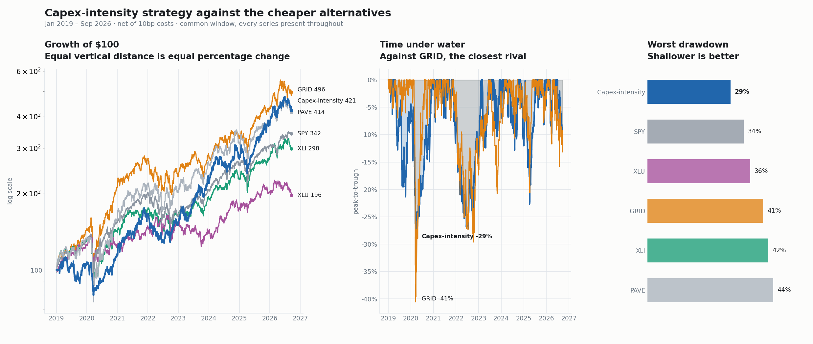

# Capex-Intensity Long/Short

**Strategy summary — 22 September 2026**

| | |
|---|---|
| **Classification** | Long/short equity, sector-focused (US power & electrification) |
| **Objective** | Capture the electricity build-out through the firms that supply it, partly funded by shorting the firms that finance it |
| **Universe** | ~150–190 US-listed issuers, defined mechanically from regulatory filings |
| **Positions** | ~22 long / ~22 short |
| **Turnover** | ~1.0× per annum |
| **Risk control** | 20% annualised volatility target |
| **Capacity constraint** | Short book borrow (see §6) |
| **Status** | Implemented and tested. **Not live; results are simulated.** |

---

## 1. Investment thesis

US electricity demand has inflected after two decades of flat consumption. Meeting it
requires capital — generation, transmission, substations, switchgear, and the construction
labour to install it.

That capital is **raised and spent by one set of companies, and earned by another.**

> Utilities, pipelines and miners *fund* the build-out and earn a regulated or commodity
> return on assets they must carry. Equipment manufacturers, electrical contractors and
> fuel-cycle suppliers *are paid by* the build-out and carry comparatively little of it on
> their own balance sheets.
>
> Both are exposed to the same activity. Only one converts it into revenue without
> simultaneously converting it into depreciation, rate-base risk and financing need.

The strategy is long the second group and short the first. The separating measure is drawn
from a single line item every issuer is required to file, and is computed strictly from
information available on the day it was filed.

## 2. Why this is not available off the shelf

The universe is assembled from regulatory classification rather than an index provider's
sector labels. Two consequences matter:

- **It reaches issuers that sector screens miss.** A material part of the long book files
  under classifications that bear no relation to energy, and no conventional sector filter
  recovers them without admitting several hundred unrelated companies. Identifying and
  correcting that gap is proprietary to this work.
- **It excludes issuers that sector screens wrongly include.** Three large classification
  groups that a naive energy screen would sweep in are deliberately removed.

Both decisions are documented and reproducible internally, and are the principal reason the
book differs from listed alternatives holding nominally similar names.

## 3. Performance

Net of transaction costs. Risk-free rate 4%. The selection measure was identified using
data through 2022; **2023 onward is out-of-sample.**

| period | CAGR | Volatility | Sharpe | Max drawdown | Calmar |
|---|---|---|---|---|---|
| 2019–2022 *(in-sample)* | 11.0% | 21.1% | 0.41 | −29.1% | 0.38 |
| **2023–2026 *(out-of-sample)*** | **31.8%** | 21.1% | **1.23** | −22.7% | **1.40** |
| **2025–2026 *(out-of-sample)*** | **29.5%** | 21.6% | **1.12** | −22.6% | **1.30** |
| 2019–2026 | 20.6% | 21.1% | 0.80 | −29.1% | 0.71 |

## 4. Comparison with available alternatives

Related exposure can be bought through listed funds. The relevant question is whether the
strategy improves on them after their published fees.

| | 2023–26 Sharpe | 2023–26 Calmar | 2025–26 Sharpe | 2025–26 Calmar | fee |
|---|---|---|---|---|---|
| **Capex-intensity** | **1.23** | **1.40** | **1.12** | **1.30** | — |
| Smart-grid ETF | 1.02 | 1.15 | 0.88 | 1.17 | 0.57% |
| Infrastructure ETF | 1.04 | 0.94 | 0.57 | 0.64 | 0.47% |
| S&P 500 | 1.11 | 1.13 | 0.80 | 0.93 | 0.09% |
| Industrials sector | 0.95 | 0.99 | 0.59 | 0.79 | 0.08% |
| Utilities sector | 0.30 | 0.47 | 0.22 | 0.51 | 0.08% |

The strategy exceeds every listed alternative on both measures in both periods. The
utilities sector — the most direct unmanaged expression of electricity exposure — is the
weakest, consistent with the thesis, since utilities constitute the short book.

## 5. Portfolio characteristics

- **Net long by construction.** The short book is sized at a fraction of the long book. It
  is a **risk-management position, not a return driver** — it is expected to lose money in
  isolation and is held for its behaviour against the long book.
- **Low turnover.** Approximately 1.0× per annum; the signal is a slow-moving balance-sheet
  measure, not a trading signal.
- **No duration bet.** Sensitivity to daily changes in 10-year real yields is statistically
  indistinguishable from zero.

## 6. Risk factors

**6.1 Cycle dependence.** Returns are earned while the capital cycle runs; in-sample Sharpe
was 0.41. A formal exit condition is specified internally and monitored quarterly.

**6.2 Rate environment.** Although the book carries no measurable duration beta, it
performs materially better when real yields are high or rising (Sharpe 0.95) than when they
are low or falling (0.58). A sustained easing cycle is the adverse environment.

**6.3 Short-side borrow.** Several short-book constituents are small and may be
unborrowable. The short book should be assumed partially unfillable, which caps capacity.

**6.4 Concentration.** Approximately 22 positions per side in a single sector.

**6.5 Correlation to related mandates.** Correlation to a long-only electrification book is
approximately 0.78. This is not an independent allocation.

## 7. Limitations and disclosures

**7.1 Survivorship.** Price history is sourced from a provider that does not carry delisted
securities. The long book is therefore flattered by the absence of failures and the short
book understated. Resolution requires survivorship-free pricing, which is a stated
pre-live condition.

**7.2 Simulated.** No capital has been allocated. All results are simulated and net of
assumed costs.

**7.3 Selection risk.** The selection measure was chosen from a set of candidates evaluated
against historical outcomes. The specification requires no such reference once stated, but
forward observation is the only conclusive test.

**7.4 Factor overlap.** The measure is related to documented quality and capital-discipline
factors. The strategy is a sector-specific application rather than an independent anomaly.

---

*Full specification, leg-level attribution, lexicon design study, cross-sector tests and
the complete weakness register are held internally and available under agreement.*
