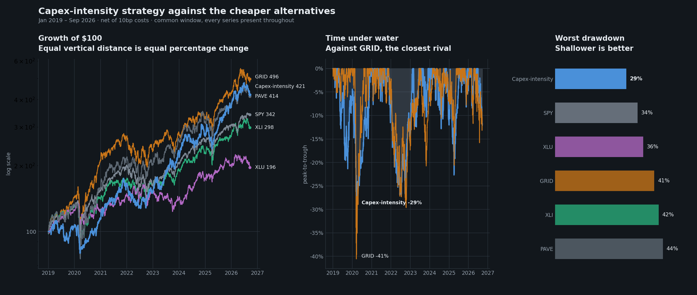
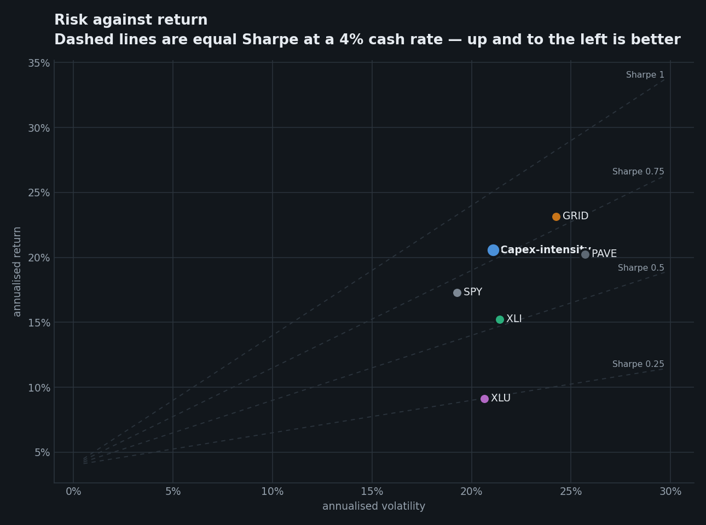
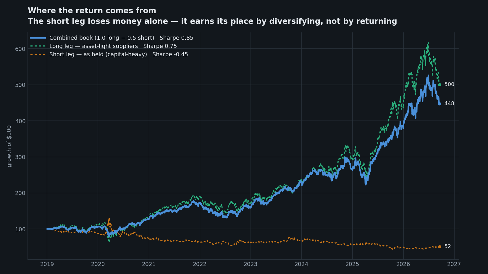

# Capex-Intensity Long/Short — Research Details

**Internal. Full specification, evidence, traps and known weaknesses. Not for distribution.**
Version 22 September 2026 · implemented in `capex_intensity_strategy/` · not live.

---

## 1. The rule, in full

**Universe (mechanical, point-in-time).**

1. **Structural screen.** Every US 10-K filer whose SEC SIC code is in the electrical/power
   set: `1731` electrical work · `3470` coating · `3490` fabricated metal · `3510` engines
   & turbines · `3550` special industry machinery · `3561` pumps · `3569` general
   industrial machinery · `3585` HVAC · `3590` misc industrial · `3600` electronic &
   electrical equipment · `3612` transformers · `3613` switchgear · `3620` electrical
   apparatus · `3621` motors & generators · `3670` electronic components · `3679`
   components NEC · `3690` misc electrical · `3823`/`3829` instruments · `5063` electrical
   wholesale · `1623` **power-line construction** · `4911` electric services · `4922`/`4923`/
   `4924` gas transmission & distribution · `4931` electric & other combined · `4991`
   cogeneration · `1221` coal.
   **Excluded deliberately:** `3674` semiconductors (505 filers; admits AMD/AVGO/ARM),
   `1311` crude oil & gas (~900), `1040` metal mining (523, mostly gold).
2. **Lexicon screen.** Any filer whose 10-K/40-F/20-F in the two preceding years contains
   *"uranium concentrates"*, *"nuclear fuel cycle"*, *"uranium enrichment"*, *"yellowcake"*
   or *"enriched uranium"*. Effective from that universe-year forward.
3. **Liquidity.** Trailing 1-year median dollar volume > $10M, re-tested monthly.

**Score.** Point-in-time TTM capital expenditure ÷ TTM revenue, from EDGAR `companyfacts`,
keyed on each fact's `filed` date. Only single-quarter flow facts (60–200 day spans).
Four filed quarters required. Restatements resolve to latest-filed-as-of-date.

**Book.** Long lightest quartile equal-weighted; short heaviest quartile at **0.5×**;
monthly rebalance; 10bp costs; 20% vol target, leverage cap 1.5×.

## 2. Performance

| period | CAGR | Vol | Sharpe | MaxDD | Calmar |
|---|---|---|---|---|---|
| 2019–2022 *(in-sample)* | 11.0% | 21.1% | 0.41 | −29.1% | 0.38 |
| **2023–2026 *(OOS)*** | 31.8% | 21.1% | **1.23** | −22.7% | **1.40** |
| **2025–2026 *(OOS)*** | 29.5% | 21.6% | **1.12** | −22.6% | **1.30** |
| 2019–2026 | 20.6% | 21.1% | 0.80 | −29.1% | 0.71 |





## 3. Leg decomposition — where the return actually comes from



| leg | 2023–26 Sharpe | 2025–26 Sharpe | 2019–26 Sharpe | 2019–26 CAGR |
|---|---|---|---|---|
| **Long — asset-light suppliers** | 1.12 | 1.09 | 0.75 | +23.3% |
| **Short — as held (capital-heavy)** | **−0.42** | **−0.40** | **−0.45** | **−8.2%** |
| Short basket viewed long-only | −0.02 | −0.03 | +0.08 | +3.4% |
| **Combined 1.0L − 0.5S** | **1.24** | **1.24** | **0.85** | +21.5% |

**The short leg loses money standalone and still improves the book** — Sharpe 1.12 → 1.24.
It is a *hedge, not an alpha source*. A position improves portfolio Sharpe when its own
Sharpe exceeds `correlation × portfolio Sharpe`, which is a much lower bar than zero. This
is the same arithmetic recorded in `docs/RESEARCH-LOG.md` (interconnection-queue thread).

Practical consequence: **do not market the short leg as a return driver, and do not size it
as one.** Past 0.5× it degrades the book.

## 4. Interest-rate sensitivity

| measure | result |
|---|---|
| Beta to daily change in 10y **real** yield | **−0.0001, t = −0.03** — rate-neutral |
| High real-yield regime (above expanding median) | Sharpe **0.95**, CAGR 24.4% |
| Low real-yield regime | Sharpe **0.58**, CAGR 14.9% |
| Real yields *rising* (3m change > 0), 2025–26 | Sharpe **1.57** |
| Real yields *falling*, 2025–26 | Sharpe **0.60** |

**It has no measurable duration beta, but it is structurally long the cost of capital.**
The short leg is capital-hungry, long-duration businesses — utilities, pipelines, developers
— whose valuations and economics improve when capital is cheap. Expensive capital punishes
them and rewards the asset-light long leg.

**Weak environment: a sustained low or falling real-rate regime** (Sharpe 0.58 vs 0.95).
That is the mirror image of the shipped Screened Electrification book, whose disclosed
primary risk is also a falling-rate reversal — so the two books share this exposure rather
than offsetting it.

## 5. Does the short leg help the shipped book?

**Yes — materially, and more than it helps its own book.**

| base | + capex short | 2023–26 Sh / Cal | 2025–26 Sh / Cal |
|---|---|---|---|
| `screen +val+sleeve` | 0.00× | 1.56 / 1.82 | 1.30 / 1.57 |
| | **0.25×** | **1.67 / 2.02** | **1.41 / 1.74** |
| | 0.50× | 1.62 / 2.08 | 1.40 / 1.79 |
| `screen +val+sleeve+short` | 0.00× | 1.54 / 2.31 | 1.46 / 2.32 |
| | **0.25×** | **1.59 / 2.66** | **1.56 / 2.60** |
| | 0.50× | 1.47 / 2.69 | 1.48 / 2.64 |

A **0.25× capex-intensity short sleeve improves the shipped book on both metrics in both
windows** — the best single result produced in this line of work
(2025–26 Sharpe 1.56, Calmar 2.60). It also stacks with the existing DLR/EQIX short rather
than replacing it: the two hedge different things (capital intensity vs rate-sensitive
duration).

**This is arguably the most commercially useful finding here** — it improves an
already-shipped book without changing its long leg.

## 6. Does capital intensity work outside power?

| universe | names | 2023–26 Sh / Cal | 2025–26 Sh / Cal | 2019–26 Sh |
|---|---|---|---|---|
| **Power / electrification** | ~150–190 | **1.23 / 1.40** | **1.12 / 1.30** | **0.80** |
| Non-power industrials (7 themes) | 74 | 0.79 / 1.20 | 0.46 / 0.79 | 0.52 |
| — semicap | 13 | 0.11 / 0.10 | 0.39 / 0.55 | 0.26 |
| — reshoring / E&C | 14 | 0.48 / 0.48 | 0.71 / 1.21 | 0.46 |

**The factor is not power-exclusive, but power is where it works.** Outside power it is
positive and roughly half to a third as strong. Two readings, and I cannot separate them
with this evidence:

- *Economic:* power is where the capital cycle is currently most extreme, so the
  supplier/owner distinction bites hardest.
- *Statistical:* the non-power test has 74 names against 150–190 and a shorter effective
  history, so it is a weaker test rather than a weaker effect.

**Implication:** treat it as a sector-specific application. Do not market it as a general
equity factor without running the broad test properly.

## 7. Lexicon design — why nuclear only

Seven alternative lexicons were tested against one standard: *does the vocabulary recover
issuers the SIC screen cannot reach, without admitting unrelated ones?*

| lexicon | listed | new vs SIC | what the new names were |
|---|---|---|---|
| **Nuclear fuel cycle** | 42 | 16 | **Cameco, Centrus, Denison, NexGen, enCore, Ur-Energy** |
| Battery storage | 94 | 53 | Albemarle, BHP, micro-caps |
| Hydrogen | 66 | 46 | BP, Chevron, Air Products, CF |
| Solar | 52 | 37 | Applied Materials, CleanSpark |
| Wind | 34 | 24 | Eni, Equinor, Enbridge |
| Marine / tidal | 9 | 6 | TechnipFMC, Oceaneering, Ecopetrol |
| Geothermal | 6 | 5 | Newmont, Schlumberger |

**Nuclear vocabulary is a term of art; the others are ESG boilerplate.** An issuer writes
"yellowcake" only if it handles the material. "Offshore wind" and "tidal energy" appear in
every integrated oil company's sustainability section.

Other verticals need no lexicon because SIC already reaches them: storage (Fluence, Eos,
Enovix, Amprius — all 3690), hydrogen (Plug, Bloom, FuelCell, Ballard — all 3620),
geothermal (Ormat — 4911). **Nuclear fuel was the only genuine structural gap: 0 of 8
names reachable.**

**Widening was tested and rejected:**

| variant | 2023–26 Sharpe | 2025–26 Sharpe |
|---|---|---|
| Nuclear only (shipped) | **1.23** | **1.12** |
| + solar | 0.90 | 1.01 |
| + wind | 1.23 (no change) | 1.12 |

Solar costs a third of the Sharpe. ARRY and NXT are genuinely asset-light so they rank as
*longs*, but their revenue depends on subsidy and they have no pricing power.
**Capital intensity measures where capital sits, not whether revenue is durable** — a real
and unfixed limitation of the signal. Wind changes nothing: no US-listed pure-play wind
manufacturer clears the liquidity floor (BWEN too small, TPIC delisted).

## 8. What electricity/energy-market knowledge is actually load-bearing

Honest accounting, because most of it turned out **not** to be:

**Load-bearing:**
- **Merit-order economics — knowing who funds capacity and who is paid by it.** This is the
  entire thesis and it is domain knowledge, not a screen someone would reach by accident.
- **SEC classification of the fuel cycle.** Knowing that uranium miners file under generic
  mining codes is why the universe is complete. No amount of statistics recovers it.
- **Fuel-cycle vocabulary.** Knowing "yellowcake" and "uranium concentrates" are terms of
  art while "green hydrogen" is boilerplate.
- **Intermittent vs firm capacity.** Knowing why solar suppliers are structurally different
  from switchgear suppliers explains §7's failure rather than leaving it a mystery.

**Not load-bearing — tested and failed (see `docs/power-market-signal-root-cause-results.md`):**
- ISO/LMP prices, congestion, load forecasts, generation mix, capacity auctions, storage
  levels, spark spreads, weather. **~42 attempts.** The mechanism: *energy futures markets
  efficiently price public power fundamentals, and equities price off those futures*, so
  public ISO data reaches equities already impounded.
- Grid-stress indices specifically: a rolling grid-stress beta **inverts** — by 2025–26 it
  ranks intermittent solar as most stress-exposed and uranium/merchant generation as least.

**The usable conclusion: power-market knowledge pays in *classification*, not in *timing*.**
It tells you which companies belong in the universe and why the categories differ. It does
not tell you when to be long.

## 9. Known weaknesses

1. **Cycle dependence.** In-sample Sharpe 0.41. Kill condition: light-minus-heavy basket
   spread flat for four consecutive quarters → stand down.
2. **Metric selection used ex-post labels.** Eleven metrics screened against a
   hand-classified list; capex intensity won at t = −15.1 vs −7.2 next best. The stated
   rule needs no labels, but the *choice* was outcome-informed. Only forward OOS resolves.
3. **Factor overlap.** Related to documented asset-light/quality factors. Untested against
   a generic version outside this sector.
4. **Borrow.** Utilities are borrowable; EOSE/SLDP/SERV/NRGV are not. Assume the short book
   is partially unfillable.
5. **Survivorship — unfixed.** 2,168 of 2,535 filers in these SIC codes have no current
   listing; yfinance serves no delisted prices. Long legs flattered, short legs understated.
   **Affects the shipped book equally.** Needs CRSP or equivalent.
6. **Correlation 0.78 to the shipped book.** These are not independent allocations.

---

## 10. Full specification — step by step

Everything needed to rebuild the strategy from nothing. Each step names the module and
function that implements it.

### Step 1 — Resolve ticker → CIK
`edgar.ticker_to_cik()` → `https://www.sec.gov/files/company_tickers.json` (~10,459 filers),
cached as `data/cache/ticker_cik.json`.

> **Trap:** SEC returns **HTTP 403** unless the `User-Agent` carries a contact address, and
> `www.sec.gov/files/*` additionally rejects an explicit `Accept: application/json` (while
> `efts.sec.gov` requires it). `_headers(accept_json=False)` handles the split. Both cost a
> silent failure when first built.

### Step 2 — Enumerate the structural universe
`edgar.sic_population(sic)` → `browse-edgar?action=getcompany&SIC=…&type=10-K&output=atom`,
paginated 100 per page to a 900 cap, parsed with
`<company-info[^>]*>` → `<cik>`. Run for every code in `data/sic_codes.csv`.

> **Trap:** the tag carries attributes, so a bare `<company-info>` regex matches nothing, and
> EDGAR emits mangled `ARRAY(0x…)` company names — take the CIK, ignore the name.

Codes, and the three deliberate exclusions, are listed in §1.
Yield: **2,535 filers, 367 currently listed.**

### Step 3 — Discover the fuel cycle by language
`universe.discover_lexicon_members(fetch, cik_to_ticker, years)`.
For each universe-year *Y*, query `efts.sec.gov/LATEST/search-index` with
`forms=10-K,40-F,20-F` and `startdt=Y-2-01-01`, `enddt=Y-1-12-31` — **strictly before *Y*
begins** — for each phrase in `config.FUEL_CYCLE_LEXICON`. Union the CIKs, map to tickers,
record the year. A name stays eligible from its first qualifying year onward.

`fetch_ciks` is injected rather than imported, so this is testable with no network.

### Step 4 — Price and liquidity
Adjusted closes and volume for every candidate plus benchmarks. Require
`MIN_PRICE_HISTORY_DAYS = 400`. `universe.liquidity_mask()` computes a
**252-day rolling median dollar volume** (min 120 periods), resampled to month-end, and
requires **> $10M**. The universe therefore breathes: 100 names (2019) → 131 (2023) → 159 (2025).

### Step 5 — Pull point-in-time fundamentals
`edgar.company_facts(cik)` → `data.sec.gov/api/xbrl/companyfacts/CIK##########.json`.
Keep only `us-gaap` USD facts from **10-Q/10-K** with all of `start`, `end`, `filed`, and a
span of **60–200 days**.

| item | tag preference order |
|---|---|
| `revenue` | `Revenues` → `RevenueFromContractWithCustomerExcludingAssessedTax` → `…IncludingAssessedTax` → `SalesRevenueNet` |
| `capex` | `PaymentsToAcquirePropertyPlantAndEquipment` |

**First tag with data wins** (`break`), so a filer reporting both `Revenues` and the ASC-606
tag is not double-counted.

> **Why the 60–200 day span filter:** XBRL mixes quarterly, year-to-date and annual facts
> under the same tag. Without it a trailing-four-quarter sum silently double-counts.

### Step 6 — Build the TTM panel, point-in-time
`fundamentals.ttm_panel(facts, dates)`. For each month-end *d*:

1. `visible = facts[facts.filed <= d]` — **the single most important line in the codebase.**
2. `groupby(ticker, item, end).last()` on filing order — restatements resolve to the most
   recently filed value *as known at d*.
3. Take the last **4** quarter-ends by `end` and sum.
4. **Skip** any ticker-item with fewer than 4 filed quarters — no partial year is annualised.

### Step 7 — Score
`fundamentals.capex_intensity(panel)` → wide date × ticker frame of
**TTM capex ÷ TTM revenue**, with revenue ≤ 0 mapped to NaN.

> **Trap:** `pivot_table` drops all-NaN columns by default, so a name with unusable revenue
> would vanish silently instead of being excluded explicitly. `dropna=False` keeps it as a
> visible NaN column.

### Step 8 — Eligibility mask
`universe.membership()` = liquidity mask **AND** lexicon effective-date mask. Structural (SIC)
members always pass the lexicon leg; lexicon members pass only from their first qualifying year.

### Step 9 — Target weights
`backtest.target_weights(score, mask, quantile=0.25, short_weight=0.5)`:

```
eligible = score.where(mask)
ranks    = eligible.rank(axis=1, method="first")
n        = eligible.notna().sum(axis=1)
n_pick   = max(1, round(n * 0.25))   if n >= 2 else 0
longs    = ranks <= n_pick
shorts   = ranks >  n - n_pick
weights  = longs/‖longs‖ − shorts/‖shorts‖ × 0.5
```

> **Trap — this one is load-bearing.** Selecting by *percentile* (`rank(pct=True)`) with the
> default `average` tie handling **can empty a leg entirely**: eight tied names in a 13-name
> pool all land at pct 0.35 and none clear a 0.25 cut, while the short bucket fills normally.
> Counting with `method="first"` guarantees both legs are populated and raised realised
> breadth from ~15/16 to **22/22 names**.

Long leg is fully invested; short leg is scaled to 0.5×. **The book is net long by design.**

### Step 10 — Returns, costs, volatility target
`backtest.run(weights, returns)`:

1. Hold weights between rebalances, apply with a **one-day lag** (`held.shift(1)`).
2. Charge `|Δweight| × 10bp`.
3. Scale by `min(20% / trailing-42-day realised vol, 1.5)`, lagged one day.
4. Charge the leverage change itself — **vol targeting is not free.**

> **API note:** `cost` and `vol_target` take `None` to mean *use the config default*. Pass
> **`0`** to disable. `vol_target=None` silently *enables* 20% targeting — this cost a
> confusing debugging session and now has a regression test.

### Step 11 — Reporting
`backtest.summarise()` uses the repo-standard `grid_equipment_basket.backtest.compute_metrics`
at **RF = 4%**, so every figure is comparable with the shipped book.
`backtest.diagnostics()` reports average long/short breadth and annualised turnover.

---

## 11. Implementation map

| module | responsibility | network? |
|---|---|---|
| `config.py` | every frozen parameter; never revised from results | no |
| `edgar.py` | `ticker_to_cik` · `sic_population` · `full_text_ciks` · `company_facts` · `fetch_facts` | **yes — the only one** |
| `fundamentals.py` | `load_facts` · `ttm_panel` · `capex_intensity` | no |
| `universe.py` | `load_sic_codes` · `liquidity_mask` · `lexicon_mask` · `membership` · `discover_lexicon_members` | no |
| `backtest.py` | `target_weights` · `run` · `diagnostics` · `summarise` · `format_summary` | no |
| `plots.py` | comparison figures, light and dark validated palettes | no |
| `pipeline.py` | end-to-end build, returns every intermediate | via `edgar` |
| `__main__.py` | CLI | via `pipeline` |
| `data/sic_codes.csv` | the only seed data | — |

All logic is pure; `edgar.py` is the sole network boundary, which is why the 18 tests run
offline against synthetic filings.

### Caches written to `data/cache/`
`ticker_cik.json` · `candidates.parquet` · `lexicon_members.json` · `prices.parquet` ·
`dollar_volume.parquet` · `edgar_facts.parquet`. Delete any to force a refetch, or pass
`--refresh`.

### Running it

```
python -m capex_intensity_strategy                    # cached
python -m capex_intensity_strategy --plot             # + comparison charts
python -m capex_intensity_strategy --short-weight 0   # long only
python -m capex_intensity_strategy --refresh          # re-fetch (20-40 min)
```

Outputs `summary.csv`, `daily_returns.csv`, `weights.csv`, `diagnostics.csv`.

### Test coverage (`tests/capex_intensity_strategy/`, 18 tests, offline)
Point-in-time filing visibility · four-quarter requirement · light-vs-heavy separation ·
NaN on non-positive revenue · liquidity exclusion · lexicon effective-dating · lexicon
look-back window closing before the universe year · long/short side correctness · leg sizing ·
long-only mode · cost and vol-target behaviour · **no-lookahead** · breadth diagnostics ·
SIC-table exclusions.

### Rebuilding this document

```
python utils/render_md.py output_html/capex-intensity-research_details.md \
    --out output_html --theme dark
python utils/render_md.py output_html/capex-intensity-proposal.md \
    --out output_html --theme prospectus
```

## 12. Reproduction

    python -m capex_intensity_strategy --plot
    python -m capex_intensity_strategy --short-weight 0     # long only
    python -m capex_intensity_strategy --refresh            # re-fetch EDGAR + prices

Tests: `tests/capex_intensity_strategy/` (18, offline).
Evidence: `docs/capex-intensity-rule-results.md`,
`docs/algorithmic-long-short-books-results.md` §6, `docs/RESEARCH-LOG.md`.
