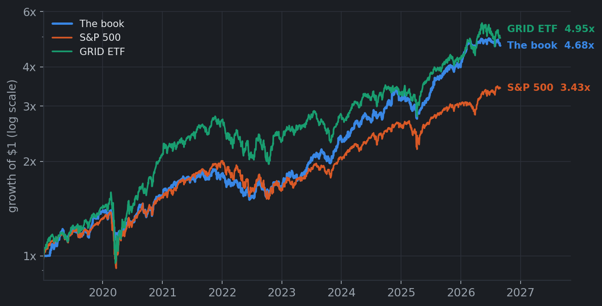
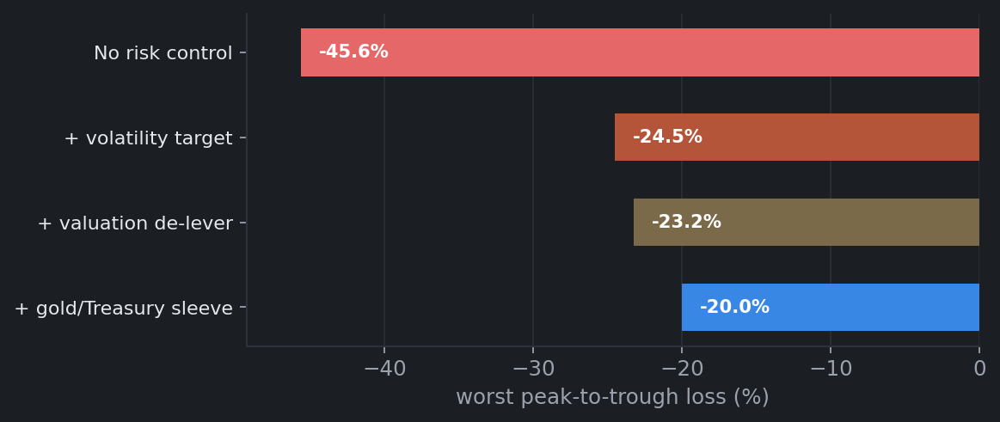
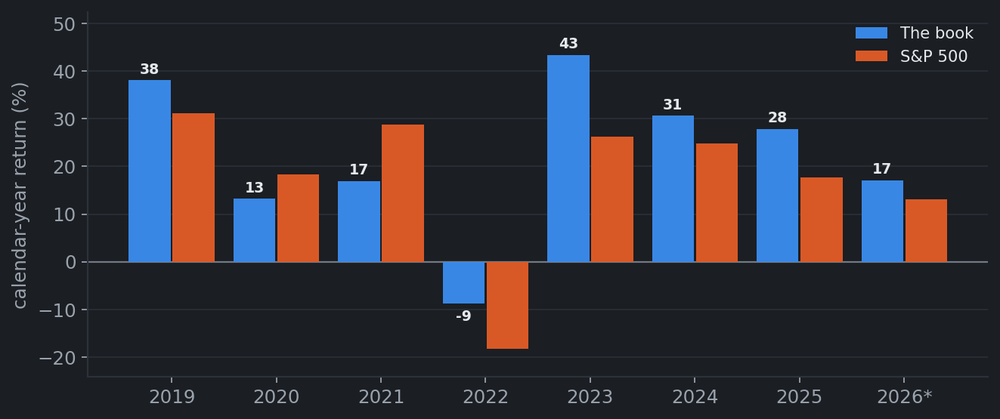
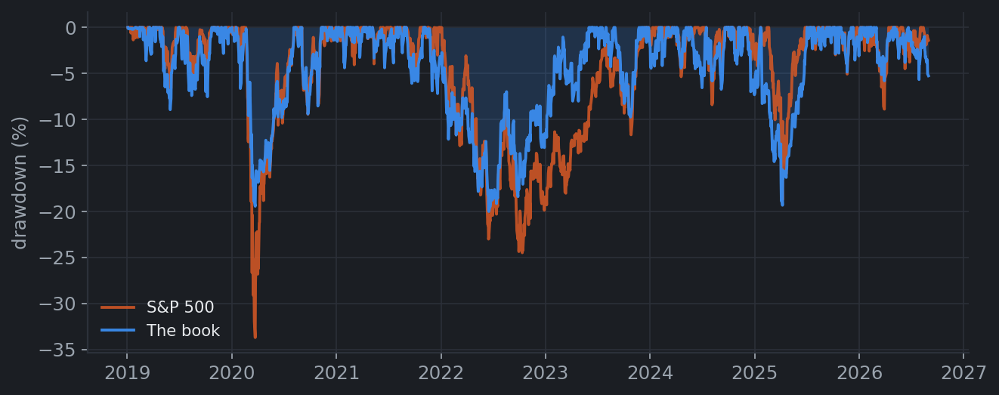
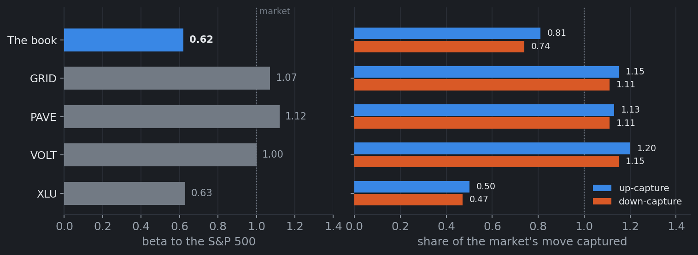
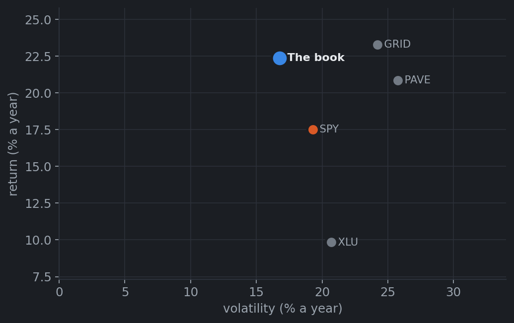
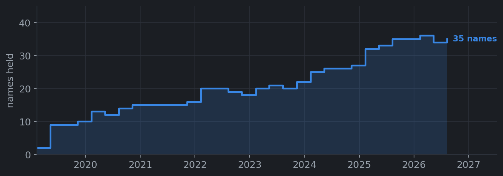
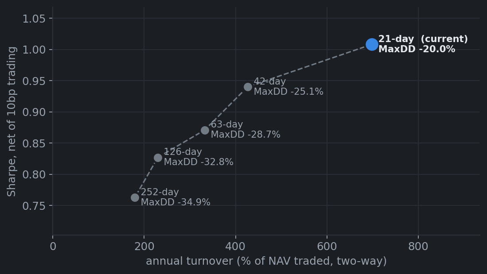
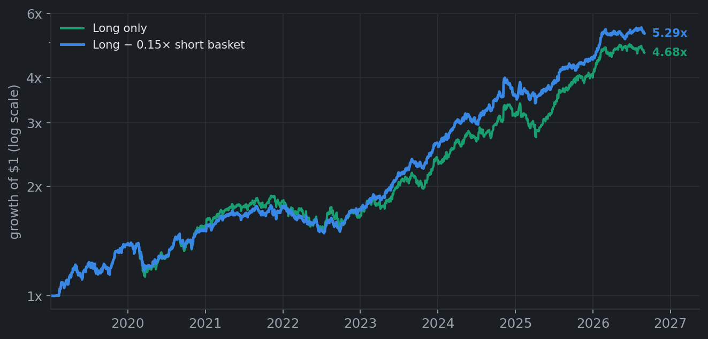

# Screened Electrification Equipment — the mechanical book

**A long-only portfolio of the companies paid to build out the electricity grid.**
Every name is selected by rule from SEC filings. There is no hand-written list.

*Window: January 2019 – August 2026 · Trading costs estimated in [Costs](#what-it-costs-to-run); management fee not assumed*

---

## The idea

Electricity demand is growing faster than the grid can carry it. Data centres, electrification of
transport and heat, and the retirement of older generation are all arriving at once, and the wires,
transformers and substations in between were built for a smaller world.

Someone has to pay for that. **We would rather own the companies being paid than the companies
paying.**

A regulated utility spends about **44 cents of every revenue dollar** on physical assets, then waits
a decade — and a regulator's approval — to earn a return on it. The equipment makers and electrical
contractors selling it transformers, switchgear and installation labour spend about **2 cents**.
They get paid now, in cash, at the top of the cycle. Same boom, opposite sides of the balance sheet.

That ~20× gap in capital intensity is the heart of the strategy, and it is a fact in the accounts
rather than a judgment call — which is what lets the whole portfolio be built by rule.

---

## Why we own what we own

**1. We buy suppliers to the grid, not owners of the grid.**
We keep only companies whose capital spending is low relative to sales. This is the "receives the
buildout money" test, and it separates a contractor from a utility without anyone having to decide
which is which.

**2. A company has to tell us, in its own filings, that this is its business.**
We include a firm only if its annual report discusses data centres, substations, switchgear,
transmission or grid modernisation. We use the company's own legally-binding disclosure rather than
a sector label, because labels are broad and stale — "Industrials" holds hundreds of firms with no
grid exposure at all.

**3. It has to have been profitable, judged on what was knowable at the time.**
This theme attracts story stocks — firms promising grid revenue that never arrives. Requiring real
reported earnings screens them out. We use the earnings *as published on the day*, never as later
restated, so we never credit ourselves with knowledge we could not have had.

**4. We avoid businesses that depend on subsidies.**
If a firm's filings lean on the investment tax credit or net metering, you are not only buying
electricity demand — you are buying an election result. We want the structural driver.

**5. It has to be liquid enough to actually trade.**
Every name must have traded at least $10m of stock on a typical day over the past year. A portfolio
you cannot enter or exit at scale is not a portfolio, it is a chart.

**6. We do not back our own stock-picking within the list.**
Every name gets equal money, capped at 25%, rebalanced quarterly. We have confidence in the
*screen*; we have no evidence we can rank winners inside it, so we do not pretend to.

Today that produces a **35-name portfolio**. Every filter reads only documents published *before*
the year it is deciding, so the portfolio you see for any past date is one you could have actually
held on that date.

---

## How we control risk

The stock selection produces a volatile book. Three layers sit on top of it, and together they cut
the worst loss by more than half.

**7. We cut size when the book gets volatile.**
Position size is scaled to target 20% annual volatility. This is the single most valuable thing we
do — and it works automatically, without anyone having to call a top.

**8. We cut size again when the book gets expensive.**
When the portfolio has run far above its own trend or dramatically ahead of the market, we step
exposure down. This is not a forecast that the theme is over; it is a refusal to hold maximum size
after prices have already moved a long way in our favour.

**9. We hold 15% in gold and Treasuries.**
It costs roughly 2% a year in return and buys the last 3 points of drawdown protection. It earns its
place by being uncorrelated with everything else we own, precisely when that matters.

**10. The portfolio we are proposing is long only.**
Shorting the capital-heavy utilities as a hedge lost money in every period tested and fell
*alongside* the portfolio on bad days — a position correlating +0.60 with what you are hedging is
not insurance. Downside protection comes from 7 and 9. We have since found **one** short that does
work on the numbers, and it is described [below](#the-short-leg-we-tested) — we are not including
it, for reasons of borrow rather than performance.

---

## Performance

### Headline

| | The book | Hand-picked version | S&P 500 | GRID ETF | VOLT ETF | Utilities (XLU) |
|---|---|---|---|---|---|---|
| **Return a year** | **22.4%** | 21.0% | 17.5% | 23.3% | 22.8% | 9.8% |
| **Volatility** | **16.8%** | 16.4% | 19.3% | 24.2% | 25.5% | 20.7% |
| **Sharpe ratio** | **1.05** | 1.00 | 0.73 | 0.82 | 0.78 | 0.36 |
| **Sortino ratio** | **1.50** | 1.36 | 0.89 | 1.07 | 0.99 | 0.47 |
| **Worst drawdown** | **−20.0%** | −23.2% | −33.7% | −40.6% | −23.4% | −36.1% |
| **Calmar ratio** | **1.12** | 0.91 | 0.52 | 0.57 | 0.97 | 0.27 |
| **Beta to S&P** | 0.62 | 0.62 | 1.00 | 1.07 | 1.00 | 0.63 |
| **Correlation to S&P** | 0.72 | 0.71 | 1.00 | 0.86 | 0.68 | 0.59 |
| **Up capture** | 0.81 | 0.79 | 1.00 | 1.15 | 1.20 | 0.50 |
| **Down capture** | **0.74** | 0.71 | 1.00 | 1.11 | 1.15 | 0.47 |
| **% of days positive** | 55.3% | 56.8% | 55.5% | 54.3% | 54.7% | 53.9% |

The book roughly matches the grid-themed ETFs on return while taking **a third less volatility** and
**half the drawdown**. Against the S&P it earns 4.9 points a year more at lower risk, capturing 81%
of the upside and only 74% of the downside.

*Sharpe and Sortino use a flat **4.0% risk-free rate**, applied identically to the book and to every
benchmark. That is deliberately conservative — 3-month Treasury bills actually averaged 2.84% over
this window — so using the realised rate would raise every Sharpe here by roughly 0.07 and change no
ranking. Returns are total returns, dividends reinvested.*

*VOLT listed in December 2024; its figures cover a shorter period and are not directly comparable.*

### Year by year

| | 2019 | 2020 | 2021 | 2022 | 2023 | 2024 | 2025 | 2026 YTD |
|---|---|---|---|---|---|---|---|---|
| **Return** | 38.1% | 13.2% | 16.9% | **−8.8%** | 43.4% | 30.6% | 27.9% | 17.1% |
| S&P 500 | 31.1% | 18.3% | 28.7% | −18.2% | 26.2% | 24.9% | 17.7% | 13.1% |
| **Sharpe** | 1.86 | 0.54 | 0.90 | −0.63 | 2.13 | 1.41 | 1.23 | **1.50** |
| **Calmar** | 4.28 | 0.68 | 2.35 | −0.50 | 4.50 | 4.19 | 1.45 | 4.67 |
| **Worst drawdown** | −8.9% | −19.4% | −7.2% | −17.8% | −9.7% | −7.3% | −19.3% | −5.8% |
| Names held | 7.5 | 13.5 | 15.2 | 19.2 | 20.8 | 26.0 | 33.8 | 35.0 |

**Seven of eight years positive.** The one loss, 2022, was less than half the market's. The two
weakest Sharpe years — 2020 and 2022 — were a pandemic crash and a rate shock, and in both the book
lost materially less than the index.

**2026 year to date: +17.1%, Sharpe 1.50, worst drawdown −5.8%.**

### Drawdowns

The book sat well above the market's drawdown line in the two big shocks: **−19.4% against −33.7%**
in the 2020 crash and **−17.8% against −24.5%** in 2022. Its own worst moment — **−20.0%**, bottoming
in June 2022 — came from a slide that began in late 2021 and spanned both calendar years.

One exception, in fairness: in the 2025 tariff selloff the book fell **−19.3%** against the S&P's
−18.8%. It has not protected in every episode, and that one it did not.

### Market sensitivity

The portfolio carries **0.62 beta to the S&P 500** against 1.07 for GRID, 1.12 for PAVE and 1.00 for
VOLT. It takes roughly **half to two-thirds of the market risk** those thematic funds do.

The right panel is the part beta alone hides. The portfolio captures **81% of the market's up days
and only 74% of its down days** — an asymmetry in the investor's favour. All three thematic ETFs run
the other way: GRID 1.15 up against 1.11 down, PAVE 1.13 / 1.11, VOLT 1.20 / 1.15. They deliver more
than the market in *both* directions, which is leverage rather than selection.

The comparison with utilities is the instructive one. XLU has almost exactly the same beta as this
portfolio — 0.63 against 0.62 — but arrives there by owning defensive businesses that capture only
**50%** of the upside. We arrive there by owning high-beta suppliers and then cutting exposure with
the volatility target, keeping **81%**. Same market sensitivity, opposite construction, and about 30
points more participation when markets rise.

*VOLT's figures cover its live history from December 2024 only (433 days against 1,925 for the
others). On that shorter common window the portfolio's beta is 0.68 against VOLT's 1.00, so the gap
is not an artifact of the different periods.*

### Risk and return against the alternatives

The thematic ETFs (GRID, PAVE) reach similar returns by taking 24–26% volatility. The book reaches
22.4% on 16.8%. That difference is the risk overlay, not the stock picking.

### What kind of strategy this is

This is a **smart-beta strategy**, and it should be judged against the alternatives an investor
actually has: GRID or PAVE. Against those it delivers the **same return at 0.62 beta against 1.07,
half the drawdown, Sharpe 1.05 against 0.82, and 81% up-capture against 74% down-capture where GRID
is 1.15 / 1.11.** That is a materially better way to own a theme the client has already decided to
own.

It also leaves room to be paid for. The gap between our risk-adjusted return and GRID's is worth
**3.84% a year** — that is (1.050 − 0.821) × our 16.8% volatility, i.e. the annual return we could
give up, to fees *and* trading costs together, before an investor would be better off simply buying
GRID. Trading takes about 0.70% of that at 10 basis points, leaving roughly **3.1 points for a
management fee**.

What it is not is alpha from stock selection. Hedged against GRID at a matched beta, the raw name
selection produces a Sharpe of **0.09** — choosing which grid suppliers to own adds little over
owning the sector. The advantage comes from **how much is held and when**, not from which names.

---

## What the rules actually hold

Breadth grows with the theme rather than being fixed at whatever someone wrote down once — from 7
names in 2019 to 35 today. **Current holdings (35, equally weighted):**

> AZZ · BWXT · CARR · CW · DY · EME · EMR · ETN · FELE · FIX · GNRC · HUBB · IEX · JCI · KEYS · LEU ·
> LII · MIR · MKSI · MOG-A · MWA · MYRG · NVT · PLPC · POWL · PRIM · PWR · RRX · TDY · TMO · VRT ·
> WCC · WTS · WWD · XYL

---

## What it costs to run

Two costs matter: what we pay to trade, and what a manager charges. The first is now estimated;
the second is a decision, so what follows is the **budget** available for it.

### Where the trading actually happens

| source of trading | turnover a year | at 10bp | at 20bp |
|---|---|---|---|
| Rebalancing the names, quarterly | 71% | 0.07% | 0.14% |
| **Resizing the whole book daily (the volatility target)** | **594%** | **0.59%** | **1.19%** |
| Rebalancing the gold/Treasury sleeve to 15% | 33% | 0.03% | 0.07% |
| **Total** | **698%** | **0.70%** | **1.40%** |

**Stock selection is almost free; the risk control is what costs money.** Choosing the 35 names and
refreshing them quarterly costs about 7 basis points a year. Resizing the portfolio every day — the
thing that halves the drawdown — costs roughly eight times more. Anyone evaluating this strategy
should focus their diligence there, not on the screen.

### Net of costs, against the alternatives

The ETF figures below are *as measured*: a fund's published return is already net of its expense
ratio. Only our book, which is a simulation, needs costs deducted.

| | CAGR | Vol | **Sharpe** | MaxDD | Calmar |
|---|---|---|---|---|---|
| The book — gross | 22.4% | 16.8% | 1.050 | −20.0% | 1.12 |
| — net of trading @ 2bp *(overlay run in futures/ETF)* | 22.2% | 16.8% | **1.042** | −20.1% | 1.11 |
| — net of trading @ 10bp | 21.5% | 16.8% | **1.008** | −20.3% | 1.06 |
| — net of trading @ 20bp | 20.7% | 16.8% | 0.967 | −20.7% | 1.00 |
| — net of trading @ 30bp *(punitive)* | 19.8% | 16.8% | 0.925 | −21.0% | 0.94 |
| — net of 10bp **+ a 1% management fee** | 20.3% | 16.8% | 0.949 | −20.8% | 0.98 |
| — net of 10bp **+ a 2% management fee** | 19.1% | 16.8% | 0.889 | −21.3% | 0.90 |
| **GRID ETF** *(net of its 0.58% fee)* | 23.3% | 24.2% | 0.821 | −40.6% | 0.57 |
| **S&P 500** *(net of its 0.09% fee)* | 17.5% | 19.3% | 0.725 | −33.7% | 0.52 |

**The budget.** The book can give up **3.84% a year** in total — trading plus fees — before its
Sharpe falls to GRID's, and **5.45%** before it falls to the S&P's. Trading takes 0.70% of that at
10bp, leaving roughly **3.1 points for a fee**. A 1% fee leaves the book comfortably ahead of both
benchmarks; a 2% fee still beats them; "2 and 20" would not, and we are not proposing it.

A second way to see the same thing: because the book runs at 16.8% volatility against GRID's 24.2%,
an investor who genuinely wants GRID-level risk can hold it at 1.44× and earn **30.6% a year against
GRID's 23.3%**, with a −28.9% drawdown against −40.6%.

### We tested trading less, and it is not worth it

The obvious way to cut the bill is to resize the book less often. We tested it. It is a bad trade at
every setting.

| volatility window | turnover a year | Sharpe (net of 10bp) | worst drawdown | drawdown in the 2020 crash |
|---|---|---|---|---|
| **21 days (what we run)** | 698% | **1.008** | **−20.0%** | **−19.4%** |
| 42 days | 426% | 0.940 | −25.1% | −25.1% |
| 63 days | 333% | 0.871 | −28.7% | −28.7% |
| 126 days | 230% | 0.827 | −32.8% | −32.8% |
| 252 days | 180% | 0.763 | −34.9% | −34.9% |

Halving the trading bill costs **5 points of drawdown** and more Sharpe than the trading saved. The
21-day window at a punitive 20bp (0.967) still beats the 42-day window at a generous 2bp (0.960).
The reason is visible in the last column: a fast estimate is what lets the book cut exposure inside
a crash rather than after it. **Trading frequently is not an oversight here — it is the product.**

### How precise these figures are

The turnover numbers are exact — they come from the simulated positions. The **cost per unit
traded** is an assumption: a fixed spread with no market-impact term, which understates the cost of
a large book. That is why the table shows a range rather than a single number, and why the
conclusion is framed on the 20–30bp columns as well as the 10bp one. The $10m-a-day liquidity floor
makes low single-digit basis points plausible for a book of this size; it does not prove it, and
real fills would.

**One implementation decision is still open, and it is worth more than any refinement to the
screen.** At 594% turnover a year, resizing the book is 85% of the bill. Done by trading the 35
underlying names it costs ~0.6%/yr; done in index futures or a liquid ETF — which is the normal way
to run a volatility target — it costs closer to 0.1%, and the net Sharpe moves from 1.008 to about
1.04. Nothing else on the table has that leverage.

---

## The short leg we tested

Most people expect a strategy like this to have a short side, so it is worth saying exactly what we
found. We set the bar before running anything: **a short basket must raise both Sharpe and Calmar**,
or it does not go in.

Eight candidates were tested. Seven failed. One passed, clearly.

### What works — and why the earlier attempts didn't

The winning basket is **the most capital-intensive companies in the industry that have also been
unprofitable for twelve consecutive months**. These are firms funding heavy capital spending out of
losses — a structurally poor place to be — and the market has treated them accordingly: the basket
fell **30% a year** on its own.

To be precise about what "most capital-intensive" is measured against: the ranking runs across the
**whole eligible universe** of roughly 146 names a month, not across the 35 we own. It has to — the
portfolio is by construction the capital-*light* end, so there is no heavy quartile inside it. The
two legs are mutually exclusive by definition, and the short reaches into ground the long book
excludes on purpose: five of the nineteen names ever shorted are utilities or pipelines. This is
therefore **not** a market-neutral pair trade. It is a long book of capital-light suppliers plus a
separate short of capital-heavy loss-makers — two independent bets that happen to combine well.

That is the difference. Every earlier attempt shorted something chosen because it *moved opposite*
the portfolio. This one shorts something that simply **goes down** — and a short only funds itself
if the thing you are shorting has negative expected return.

| | Sharpe | Calmar | Worst drawdown |
|---|---|---|---|
| Long only | 1.050 | 1.118 | −20.0% |
| **Long − 0.15× the short basket** | **1.367** | **1.597** | **−16.3%** |
| Long − 0.10× | 1.300 | 1.453 | −17.2% |
| Long − 0.25× | 1.345 | 1.512 | −18.6% |

It improves both measures in **both halves** of the period (2019–22: Sharpe 0.81 against 0.60;
2023–26: 2.01 against 1.55), it works across a wide range of position sizes rather than one lucky
setting, and — unlike every previous short — it **reduces** drawdown instead of deepening it. It
costs almost nothing to trade: about 0.03% a year on top of the existing bill.

### Making it less concentrated

Three names is too few to trade, so we tried to widen it. Loosening the *universe* turns out to be
pointless — the eligible pool is already as wide as the data allows (134 names against 135 if we
drop the industry gate entirely; liquidity is doing all the filtering). What works is loosening the
**capital-intensity cut**:

| capital-intensity cut | loss test | names | Sharpe @15% | Calmar @15% | tolerable borrow cost |
|---|---|---|---|---|---|
| heaviest 25% | 12 months | 3.3 | 1.367 | 1.597 | 20% |
| **heaviest 40%** | **12 months** | **4.9** | **1.300** | **1.490** | **20%** |
| heaviest 50% | 12 months | 7.2 | 1.262 | 1.456 | 10% |
| heaviest 50% | 6 months | 8.1 | 1.237 | 1.215 | 5% |
| heaviest 50% | TTM only | 8.6 | 1.221 | 1.270 | 5% |

The heaviest-40% version is the best of these: half again as many names for 0.067 of Sharpe, and it
still tolerates a 20% borrow cost. Loosening the *loss* test is the worse dial — twelve months of
losses is what produces the negative drift, and dropping it to a single quarter cuts the basket's
standalone decline from −21% a year to −10%.

### Why we are not including it

**It is one sector's bust, not a rule — and the evidence is emphatic.** The obvious objection is
that the basket's decline comes almost entirely from five hydrogen and fuel-cell names. On its own
that proves nothing: a screen hunting capital-heavy loss-makers in the electricity sector *should*
find hydrogen companies, because that is exactly what they were. Removing them removes the signal,
not a bias.

The fair test is whether the same screen picks losers in industries with nothing to do with the
grid. We ran it across a thousand-company, all-sector universe. It does the **opposite**:

| universe | qualifying names a month | what the basket did |
|---|---|---|
| Electricity only — where the rule was found | 4.9 | **−21% a year** |
| **Every other sector, identical rule** | **20.8** | **+52% a year** |
| Other sectors, capital-heavy but *profitable* (control) | 148 | +16% a year |

Outside the grid, companies funding heavy capital spending out of sustained losses are biotech, AI
infrastructure and early-stage hardware — and between 2019 and 2026 they beat their profitable peers
by 36 points a year. Shorting them would have been ruinous. So the screen does not identify
structurally bad businesses; it identifies **speculative growth**, which normally rises. It worked
in electricity only because that was the one sector whose speculative bubble deflated while the rest
of the market's kept inflating.

**It cannot be run at size.** The thinnest name in the basket trades about $10m a day. Holding a
short position without becoming a meaningful share of daily volume caps the whole fund at roughly
**$73m** — and that is at a fairly aggressive 10% participation rate. This is a small-fund trade at
best.

**Borrowing these shares is expensive.** They are among the most heavily shorted stocks in the
market — a current snapshot shows a **median 24% of free float already sold short**, SERV at 37% and
EOSE at 31%. The position survives a 20%-a-year borrow cost but fails at 40%, and we have no
historical borrow series to say which side of that line the real world sat on.

**The honest summary:** this is the first short leg in this research ever to pass a pre-registered
bar, and it is the clearest example of why passing one is not enough. Every mechanical check agreed
with it — the position size didn't matter, both halves of the period worked, it survived a simulated
100% squeeze. None of those checks was capable of detecting the problem. Only asking *"does this
work anywhere else?"* did, and the answer was that the same rule makes 52% a year on the other side
of the trade. **The book stays long only.**

---

## Finding a real hedge

The short-leg work above failed for one reason worth stating plainly: **every candidate we shorted
went down when the portfolio went down.** Measured on the portfolio's own losing days, the
capital-heavy leg correlated +0.60 with it, the data-centre REITs +0.36, the loss-maker basket
+0.32. A position that falls alongside what it is meant to protect is not insurance; it is a second
bet with extra steps.

So we searched directly on the property we actually wanted — *what rises when this book falls* —
across 44 cross-asset instruments and every one of 921 individual stocks.

**No single stock hedges this portfolio.** Only 2 of 921 had negative down-day beta, and the most
negatively-correlated names were supermarkets and household products, at barely below zero. The
most *positively* correlated names included VRT and WCC — which the portfolio owns. The book is
built from high-beta industrials, and nothing inside the equity market offsets that.

**What does work is an anti-beta position.** BTAL is a fund that holds low-beta stocks and shorts
high-beta ones. Mechanically it is this portfolio's mirror image, and the numbers bear that out:

| | drift a year | beta on the book's down days | return during the book's drawdowns |
|---|---|---|---|
| **BTAL (anti-beta)** | **−5.7%** | **−0.62** | **+27.0% a year** |
| Gold (GLD) | +17.1% | +0.19 | +12.9% |
| Gold miners (GDX) | +23.4% | +0.68 | +26.4% |
| **Long Treasuries (TLT)** | −2.4% | −0.11 | **−12.4%** |

The negative drift is the point, not a flaw: **BTAL costs about 5.7% a year to hold and pays out in
every drawdown the portfolio has had.** That is what insurance looks like. It is also the answer to
whether this is really a rates problem — it is not. Long Treasuries have the right correlation sign
day to day but *lost* money during the portfolio's actual drawdowns, because 2022 took rates and
equities down together. Duration does not hedge this book.

### What we would change

| sleeve | Sharpe | Calmar | MaxDD | beta | COVID 2020 | 2022 | 2025 tariffs |
|---|---|---|---|---|---|---|---|
| 15% GLD/IEF *(current)* | 1.050 | 1.118 | −20.0% | 0.62 | −19.3% | −17.8% | −14.1% |
| 15% GLD *(just drop the bonds)* | 1.104 | 1.193 | −20.0% | 0.63 | −19.9% | −16.9% | −14.1% |
| 20% BTAL | 1.046 | 1.118 | −16.9% | 0.48 | −16.8% | −12.5% | −10.8% |
| **25% GLD/BTAL 50/50** | **1.134** | **1.218** | **−16.7%** | **0.49** | **−16.7%** | **−12.7%** | **−10.6%** |

Two conclusions. **The bond half of the current sleeve is dead weight** — Treasuries returned 0.8% a
year over the period and failed precisely in 2022, when they were supposed to help. Dropping them
costs nothing and adds 0.05 of Sharpe. And **a half-gold, half-anti-beta sleeve at 25% improves every
measure at once**: better Sharpe, better Calmar, three points less drawdown, beta down from 0.62 to
0.49, and a smaller loss in all three of the crises the portfolio has lived through.

### Hedges that sound right but are not

Three thematically appealing hedges get proposed often enough to be worth answering with data. All
assume that if the physical build-out stalls, capital rotates to an adjacent winner:

1. **Independent power producers** (Constellation, Vistra) — they own contracted generation, so they
   win if the grid blocks new data centres.
2. **On-device AI** (Apple, Qualcomm, Arm) — if centralised data centres become unviable, AI moves to
   the edge.
3. **Optimisation software** (Alphabet, Microsoft) — if hyperscalers tire of capital spending, code
   efficiency replaces machinery.

The reasoning draws on a real precedent: in the late-1990s telecom boom, the fibre glut bankrupted
the equipment makers while the software layer captured the economics. As a *long-run* view that is
sound. As portfolio insurance it fails, and we can test it against an actual instance rather than
argue about it.

**In December 2024 the DeepSeek release delivered precisely this scenario** — the market abruptly
priced "efficient AI needs less hardware." Peak to trough:

| | the portfolio | 1. Power producers | 2. On-device AI | 3. Optimisation software | BTAL |
|---|---|---|---|---|---|
| **DeepSeek, Dec 24 – Apr 25** | −18.4% | **−28.6%** | **−29.4%** | −16.2% | **+16.9%** |
| COVID, Feb – Mar 20 | −18.8% | −23.1% | −20.6% | −29.1% | +8.9% |
| Tariffs, Mar – Apr 25 | −8.2% | −19.3% | −23.1% | −10.6% | +5.0% |

**The two baskets built for that exact scenario fell harder than the portfolio they were meant to
protect.** DeepSeek was not a rotation within AI; it was a repricing of the whole complex, and the
supposed beneficiaries of decentralisation sold off with everything else.

The power-producer basket is the clearest case: its beta on the portfolio's down days is **1.33**,
the highest of anything we tested and higher than the portfolio itself. Constellation and Vistra
*are* the AI-power trade. Buying them as insurance against AI build-out risk is buying a levered
version of the same risk.

The underlying reason matters more than the individual names: **this portfolio's risk is not "grid
equipment", it is high-beta growth equity.** Anything in that family moves together in a selloff
whatever its thesis — which is why, of 921 stocks screened, only two had negative down-day beta, and
why the only thing that works is an instrument that is structurally short beta.

### What we are cautious about

**Half of that sleeve is riding a gold bull market.** Gold returned 8.5% a year in 2019-22 and 27.3%
a year in 2023-26. If we set the sleeve's return to zero — gold does nothing from here — the
portfolio's Sharpe falls from 1.134 to 0.943. The gold allocation is a second bet dressed as a
hedge, and should be sized as one.

**BTAL is the honest half and the constrained one.** It is a $300m fund trading about $8m a day with
a 1.4% management fee (already deducted from the figures above). As an exchange-traded fund its real
capacity comes from creating shares against its large-cap holdings rather than from daily volume, so
it is more scalable than that number suggests — but it is not a position for a large book, and it
carries the model risk of someone else's quantitative strategy.

---

## Risks

**This is a concentrated bet on one theme, not a diversified equity portfolio.** Correlation to the
S&P is 0.72 and to the grid ETFs higher still. It will fall in a broad selloff; the overlay is
designed to make it fall less, not to make it uncorrelated.

**We have no exit signal.** Rules 7–9 limit what a downturn costs, but nothing here tells us when
the buildout ends. We have tested more than a dozen candidate early-warning signals built on grid
data — congestion pricing, capacity auctions, load forecasts, utility capital-spending guidance —
and none showed a usable relationship with future returns. We regard the structural tilt as sound
and our ability to time it as unproven.

**The early years are thin.** The portfolio held 7–8 names through 2019 and did not reach 20 until
2022. The strong early ratios rest on a small book, and should be discounted accordingly.

**2022 is the honest blemish.** In the one down year, the hand-picked version lost less (−0.39
Sharpe versus −0.63). A rule-based book does not get to step aside from a bad year.
