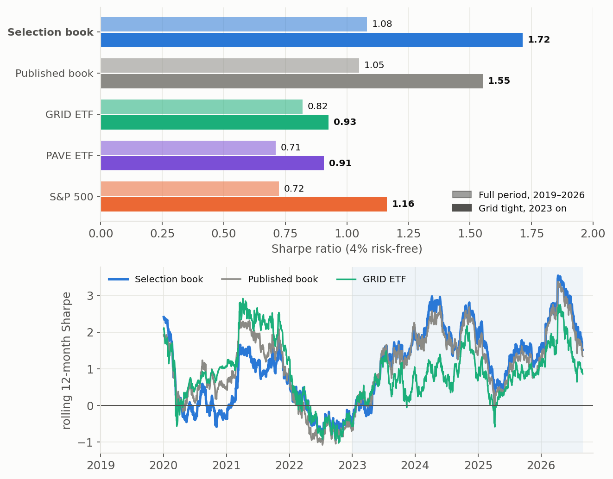
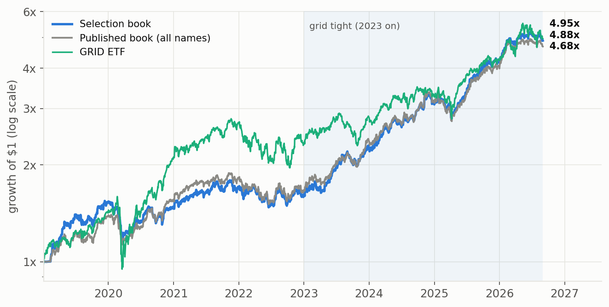
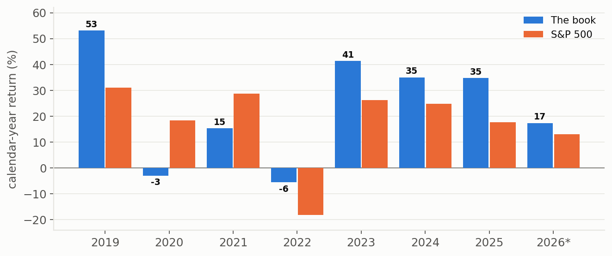
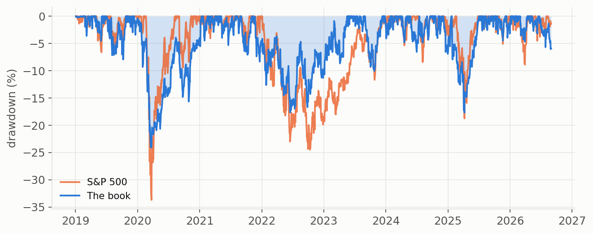
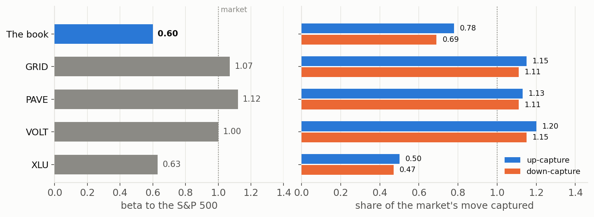
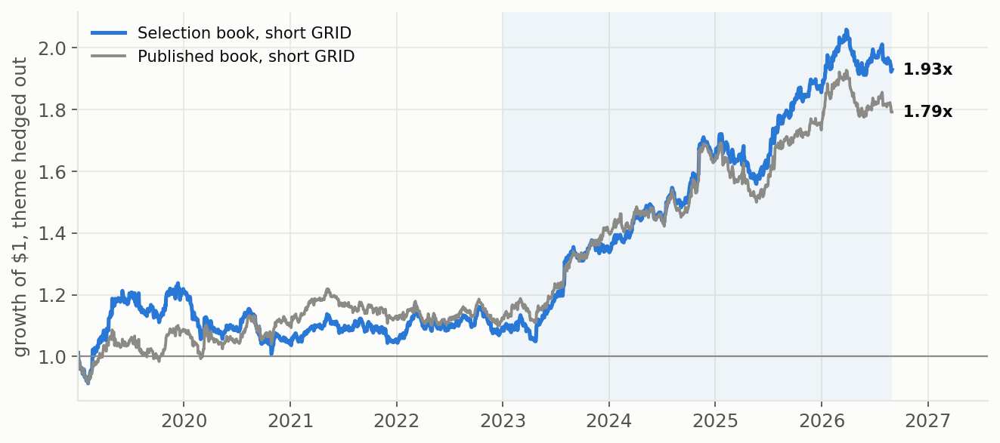
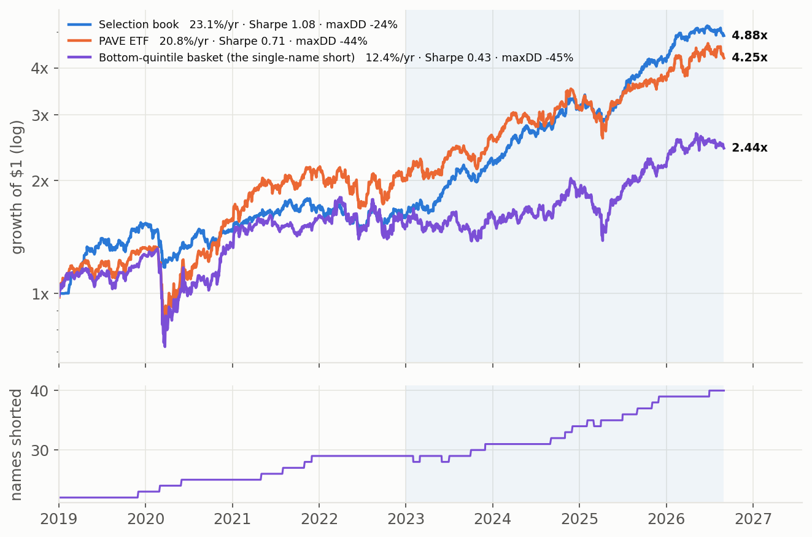
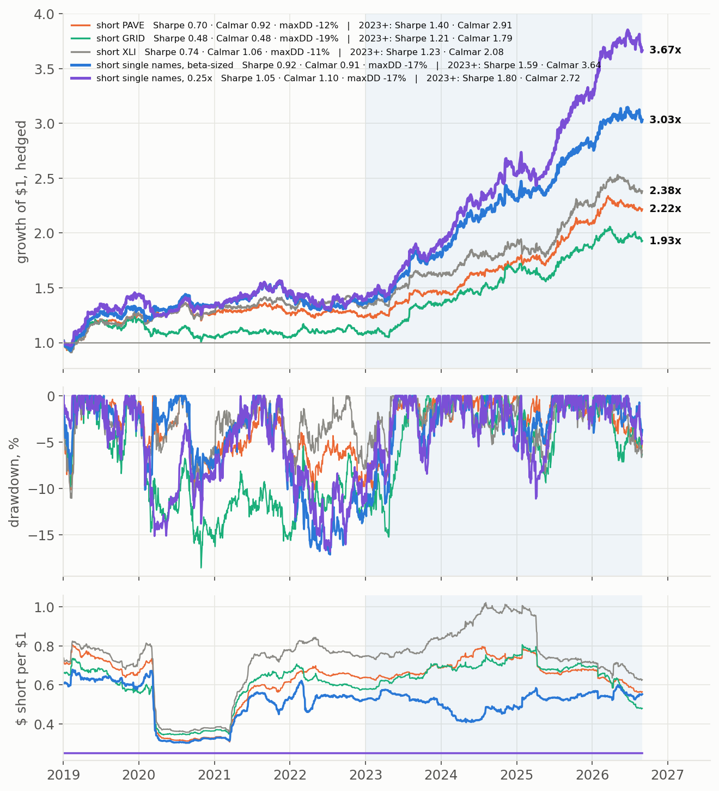
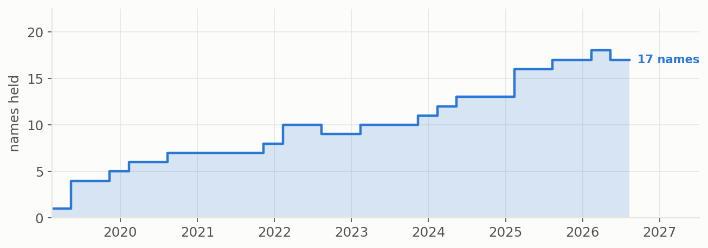

# Screened Electrification Equipment — the selection book

**The same rules-based grid-supplier portfolio, now holding only the half of it that the evidence
favours.** Every name is still selected by rule from SEC filings; the new step ranks them by two
facts in their own accounts and keeps the better half.

*Window: January 2019 – August 2026 · The grid-tight period (January 2023 on) is reported
separately throughout · Trading costs in [Costs](#what-it-costs-to-run) · Management fee not assumed*

---

## The idea in one paragraph

Electricity demand is growing faster than the grid can carry it, and someone is being paid to build
the difference. Our published book owns the suppliers being paid — equipment makers and electrical
contractors that spend about 2 cents of each revenue dollar on physical assets, against a
utility's 44 — and it deliberately did **not** try to pick winners among them: every qualifying name
got equal money. This proposal drops that last restraint. Since the grid became genuinely tight in
2023, two facts in a supplier's own filings have separated the winners from the rest, and we now use
them to hold only the stronger half.

*Return per unit of risk. Bars: Sharpe over the full period (light) and since the grid became tight (dark). Lines: Sharpe over the trailing 12 months.*

---

## What changes, and what does not

Rules 1–5 of the published book are unchanged: suppliers not owners of the grid (low capital
intensity), a company that says so in its own 10-K, profitable on the numbers known at the time, not
dependent on subsidies, and liquid. Rules 7–9 — the risk overlay — are unchanged too.

**Rule 6 is replaced.** The published book held every qualifying name equally because we had no
evidence we could rank them. We now do.

**6. We hold the half of the list that scores best on two facts from the accounts.**

- **How little the company spends on capital, relative to its sales.** Within an already
  capital-light list, the lightest keep doing better: they convert the buildout into cash now rather
  than into assets that earn later.
- **Whether its revenue growth is speeding up.** This year's growth rate minus last year's, on
  trailing-twelve-month revenue as filed. A supplier whose orders are accelerating is the one the
  buildout is reaching.

Each fact is ranked across the whole ~146-name eligible universe each month, the two ranks are
averaged, and at each rebalance we hold the top half of the qualifying names, equally weighted.
Both inputs are read from filings *as published on the day* — no restated numbers, no hindsight. The
book holds **17 names today** (14 on average since 2023), against 35 for the published book.

**Why these two and not others.** We tested fourteen candidate stock-ranking signals over the same
universe — earnings surprises, revenue surprises, momentum, reversal, and the stocks' sensitivity to
wholesale power prices, grid congestion and scarcity pricing. These were the only two with a
consistent relationship to future returns, and the power-market signals — which sound the most
relevant — ranked stocks no better than chance. We also tried adding links to related firms (10-K
text similarity, shared headquarters city): none improved the result.

---

## How we control risk

Unchanged from the published book: **7.** position size scaled to 20% target volatility; **8.** size
cut again when the book is extended far above its trend or the market; **9.** 15% held in gold and
Treasuries. The concentrated book needs these more, not less:

| stage | Sharpe | return a year | worst drawdown |
|---|---|---|---|
| Selected names, no risk control | 1.00 | 33.6% | **−47.3%** |
| + volatility target | 1.05 | 27.5% | −28.8% |
| + valuation de-lever | 1.04 | 25.2% | −28.8% |
| **+ gold/Treasury sleeve (the book)** | **1.08** | **23.1%** | **−24.1%** |

---

## No look-ahead

Every decision in the backtest uses only information that existed on the day it was made:

- **Which companies qualify** — SIC codes as filed, 10-K wording only from filings published *before*
  the year being decided, earnings and capital spending as first reported (never restated), liquidity
  over the trailing year, and a name trades only after a year of price history.
- **The ranking** — each month-end score uses filings filed by that date; a rebalance uses the latest
  month-end score *on or before* the rebalance day.
- **The risk overlay** — position size is set from volatility up to *yesterday*; the valuation cut is
  set from the *previous* month's reading.
- **The hedge** — sized from the trailing year of returns ending *yesterday*, with 2018 as the first
  trailing year (no back-filling).

What the backtest cannot remove is **research hindsight**: the two-factor ranking was chosen in
September 2026 after testing fourteen candidates on this same history. The rules use no future data,
but the choice of rules was made knowing how 2019–2026 turned out. That is addressed in
[Risks](#risks) and by the live record kept from August 2026.

---

## Performance

### Since the grid became tight (January 2023 – August 2026)

This is the period the strategy is built for, and the one to judge it on.

| | **Selection book** | Published book | S&P 500 | GRID ETF | PAVE ETF | Industrials (XLI) |
|---|---|---|---|---|---|---|
| **Return a year** | **35.4%** | 32.7% | 22.6% | 23.0% | 22.8% | 18.9% |
| **Volatility** | **16.1%** | 16.6% | 15.0% | 20.3% | 20.6% | 16.5% |
| **Sharpe ratio** | **1.72** | 1.55 | 1.16 | 0.93 | 0.91 | 0.89 |
| **Sortino ratio** | **2.43** | 2.19 | 1.59 | 1.33 | 1.37 | 1.33 |
| **Worst drawdown** | **−17.7%** | −19.3% | −18.8% | −20.8% | −26.2% | −18.5% |
| **Calmar ratio** | **2.00** | 1.69 | 1.20 | 1.11 | 0.87 | 1.02 |
| **Beta to S&P** | 0.74 | 0.79 | 1.00 | 1.10 | 1.09 | 0.90 |
| **Up / down capture** | **0.91 / 0.74** | 0.96 / 0.83 | 1.00 / 1.00 | 1.19 / 1.23 | 1.11 / 1.13 | 0.91 / 0.91 |

Against the published book it earns **2.7 points a year more with less volatility and a smaller
drawdown** — every measure improves. Against GRID it earns 12.4 points more at four-fifths of the
volatility and 85% of the drawdown.

### The full period (January 2019 – August 2026)

| | **Selection book** | Published book | S&P 500 | GRID ETF | PAVE ETF | Utilities (XLU) |
|---|---|---|---|---|---|---|
| **Return a year** | **23.1%** | 22.4% | 17.5% | 23.3% | 20.8% | 9.8% |
| **Volatility** | **16.8%** | 16.8% | 19.3% | 24.2% | 25.8% | 20.7% |
| **Sharpe ratio** | **1.08** | 1.05 | 0.73 | 0.82 | 0.71 | 0.36 |
| **Sortino ratio** | **1.58** | 1.50 | 0.89 | 1.07 | 0.93 | 0.47 |
| **Worst drawdown** | **−24.1%** | −20.0% | −33.7% | −40.6% | −44.1% | −36.1% |
| **Calmar ratio** | **0.96** | 1.12 | 0.52 | 0.57 | 0.47 | 0.27 |
| **Beta to S&P** | 0.60 | 0.62 | 1.00 | 1.07 | 1.12 | 0.63 |
| **Up / down capture** | **0.78 / 0.69** | 0.81 / 0.74 | 1.00 / 1.00 | 1.15 / 1.11 | 1.13 / 1.11 | 0.50 / 0.47 |
| **% of days positive** | 55.8% | 55.3% | 55.5% | 54.3% | 54.0% | 53.9% |

Over the full period the selection adds a little Sharpe but **costs Calmar**: its worst drawdown,
−24.1%, is four points deeper than the published book's. That loss happened in 2020, when the
book held only six or seven names — see [Risks](#risks).

*Sharpe and Sortino use a flat **4.0% risk-free rate** for every column, as in the published
proposal. Returns are total returns, dividends reinvested, before trading costs and fees.*

### Year by year

| | 2019 | 2020 | 2021 | 2022 | 2023 | 2024 | 2025 | 2026 YTD |
|---|---|---|---|---|---|---|---|---|
| **Selection book** | **53.1%** | **−3.0%** | 15.3% | −5.6% | 41.3% | **35.1%** | **34.7%** | 17.3% |
| Published book | 38.1% | 13.2% | 16.9% | −8.8% | 43.4% | 30.6% | 27.9% | 17.1% |
| GRID ETF | 42.2% | 48.8% | 27.7% | −13.9% | 21.6% | 15.2% | 29.7% | 17.1% |
| S&P 500 | 31.1% | 18.3% | 28.7% | −18.2% | 26.2% | 24.9% | 17.7% | 13.1% |
| **Sharpe** | 2.38 | −0.27 | 0.77 | −0.44 | 2.04 | 1.70 | 1.53 | 1.59 |
| **Worst drawdown** | −7.9% | −23.8% | −8.3% | −14.5% | −10.0% | −6.9% | −17.7% | −6.0% |
| Names held | 3.5 | 6.5 | 7.2 | 9.5 | 10.2 | 12.8 | 16.5 | 17.3 |

**2024 and 2025 are where the selection earns its keep** — 4.4 and 6.8 points ahead of the published
book. 2020 is where it cost the most: a six-name book that happened to hold the wrong six.

### Drawdowns and market sensitivity

The book carries **0.60 beta** to the S&P 500 over the full period (0.74 since 2023) against 1.07
for GRID, and captures 78% of the market's up days against 69% of its down days.

---

## Is this alpha?

In fairness: **yes against the grid-equipment index, in the regime it is built for — and most of that
alpha was already in the published book.** The selection step adds a smaller, less certain piece on
top.

The test is a regression of the book's daily return on GRID's: whatever return is left over after
accounting for the book's exposure to the theme is alpha. A t-statistic above 2 means the result is
unlikely to be luck. This regression is a *measurement* made after the fact over each window; the
strategy itself never uses it — the tradable, look-ahead-free version of "the book minus the theme"
is the hedged book [below](#the-hedged-version-owning-the-alpha-without-the-theme).

| alpha a year (t-statistic) | full period | 2019–22 | 2022 on | **2023 on** |
|---|---|---|---|---|
| **Selection book vs GRID** | **9.8% (2.4)** | 1.9% (0.3) | 14.6% (3.1) | **17.5% (3.2)** |
| Published book vs GRID | 8.8% (2.3) | 2.4% (0.5) | 11.8% (2.7) | 14.7% (2.8) |
| **Selection book vs published book** — *the selection itself* | 1.5% (0.8) | −0.4% (−0.1) | 3.4% (1.7) | **3.9% (1.6)** |
| Selection book vs S&P 500 | 11.4% (2.7) | 5.5% (0.9) | 14.7% (2.8) | 15.7% (2.5) |

Three honest readings:

1. **Against GRID the alpha is real and statistically strong since 2022–23** (t above 3), and it is
   positive — though small — even in 2019–22. By the test we set for ourselves before starting this
   work (positive in both halves, t at least 1.5 over the whole period), it qualifies.
2. **Most of it is not new.** The published book already beat GRID by 14.7% a year since 2023. That
   alpha comes from *how* the book is built — capital-light suppliers, the volatility target, the
   hedge sleeve — not from ranking names.
3. **The selection adds about 4 points a year since 2023, at t ≈ 1.6** — suggestive, not proven, and
   zero before 2022. It also carries a hindsight caveat: the two-factor score was chosen in
   September 2026 after testing fourteen candidates. We froze it on 24 September 2026 and record its
   picks every month from August 2026; that live record is the real test.

---

## The hedged version: owning the alpha without the theme

For an investor who already owns the theme, or wants the stock selection without the sector's swings,
the book can be run **short an index ETF against it**. The hedge size on each day is the book's beta
to the ETF over the **preceding** 252 trading days — for the first days of 2019 that year is 2018, from
the identical screening rule run over 2018, so nothing is filled in from the future. *(Corrected
25 September 2026: an earlier version left the 2018 book empty, so every hedge started 2019 near
zero and was under-sized all year. The fix changes nothing from 2022 on; the full-period and 2019–22
hedged figures below are lower than first published, because 2019 is now actually hedged — see
[the correction note](#correction-2019-hedge-sizing).)* The figures below charge **0.5% a
year to borrow the ETF and 10 basis points on every change in the hedge**.

| hedge | period | return a year | Sharpe | worst drawdown | Calmar | avg hedge per $1 |
|---|---|---|---|---|---|---|
| **short GRID** | **2023 on** | **16.8%** | **1.21** | **−9.4%** | **1.79** | $0.61 |
|  | 2022 on | 13.9% | 0.97 | −10.4% | 1.33 | |
|  | full period | 9.0% | 0.48 | −18.6% | 0.48 | |
| **short PAVE** | **2023 on** | **17.1%** | **1.40** | **−5.9%** | **2.91** | $0.62 |
|  | 2022 on | 12.8% | 0.99 | −6.5% | 1.95 | |
|  | full period | 11.0% | 0.70 | −11.9% | 0.92 | |
| **short XLI** | **2023 on** | **17.4%** | **1.23** | **−8.4%** | **2.08** | $0.73 |
|  | 2022 on | 13.1% | 0.89 | −8.4% | 1.56 | |
|  | full period | 12.0% | 0.74 | −11.3% | 1.06 | |
| **short ½ GRID + ½ PAVE** | **2023 on** | **15.8%** | **1.31** | **−7.5%** | **2.10** | $0.67 |
|  | 2022 on | 12.7% | 1.00 | −7.8% | 1.63 | |
|  | full period | 9.2% | 0.54 | −12.2% | 0.75 | |
| **short ⅓ GRID + ⅓ PAVE + ⅓ XLI** | **2023 on** | **15.9%** | **1.28** | **−7.9%** | **2.01** | $0.72 |
|  | 2022 on | 12.6% | 0.98 | −7.9% | 1.59 | |
|  | full period | 9.8% | 0.60 | −11.9% | 0.82 | |
| *Published book, short GRID* | *2023 on* | *13.6%* | *0.97* | *−11.3%* | *1.20* | *$0.64* |

**Since 2023, hedging out the theme still leaves 16–17% a year at 8.5–10% volatility,** with the
worst drawdown between −6% and −9% depending on the hedge. Over the full period the hedged book earns 9–12%
a year; almost all of it arrives after 2022 — hedging out the theme in its best early year (2019) costs
real return.

### Choosing the hedge

The fair way to pick a hedge is by how closely it tracks the book — something an investor can measure
*before* knowing the results — not by which one produced the best hedged return afterwards.

| hedge | correlation with the book, 2018–22 | risk left after hedging, 2018–22 | correlation, 2023 on | risk left, 2023 on |
|---|---|---|---|---|
| GRID | 0.73 | 11.9% | 0.78 | 10.1% |
| **PAVE** | **0.77** | **11.0%** | 0.84 | 8.7% |
| XLI | 0.76 | 11.3% | 0.77 | 10.2% |
| **½ GRID + ½ PAVE** | **0.78** | **10.9%** | **0.85** | **8.5%** |
| ⅓ GRID + ⅓ PAVE + ⅓ XLI | 0.78 | 10.8% | 0.84 | 8.7% |

**PAVE is offered as a hedge on these grounds.** It tracked the book more closely than GRID already in
2018–22, before the period the strategy is judged on, so choosing it is not hindsight. The reason is
composition: PAVE holds only US-listed infrastructure and industrial companies — contractors,
electrical equipment, machinery — which is what this book owns. GRID is global and includes electric
utilities, which the book excludes by rule, so shorting it adds exposure to utilities, European
stocks and currencies that the book does not have.

**The blends track the book best of all** (0.78 in 2018–22; the 50/50 GRID and PAVE blend 0.85 since
2023) and spread the hedge across funds, but the 50/50 blend's hedged return since 2023 (Sharpe 1.31,
Calmar 2.10) sits between the two it is made of. PAVE
alone has the best hedged figures (1.40 / 2.91). We offer GRID, PAVE and the 50/50 blend, and would
recommend **PAVE or the 50/50 blend** for an investor choosing today.

**Can you short these?** Yes. GRID is an $11.8bn fund trading about $100m a day and PAVE a $13.5bn fund
trading about $82m a day, both with listed options; XLI ($32bn, $1.3bn a day) is the most liquid of
the three. Large ETFs are normally cheap to borrow, but we have not verified these rates, which is why
we charge 0.5% a year. An institutional investor would more often use a total-return swap on the
index than a physical short.

*Hedged Sharpes use the same 4% risk-free rate and are not credited with interest on the short
proceeds, which understates them slightly.*

### A single-name short option

Instead of an index ETF, the hedge can short the **weakest names in the same eligible universe**: each
month, the bottom fifth of the ~146 eligible electrification names by a 14-signal score (method
[below](#how-the-single-name-short-is-computed)). These are capital-heavy, slowing-revenue,
weak-momentum names that sell off with the theme but have lagged it: the basket shorted here rose
12.4% a year over the full period, against 20.8% for PAVE and 23.1% for the book.

It is shown two ways: **sized like the ETF hedges** (the book's trailing 252-day beta to the basket,
no look-ahead), and as a **fixed $0.25 short per $1 of book**. Single names are charged **1% a year
to borrow** (the ETFs 0.5%), 10bp on the basket's monthly re-formation and 10bp on every change in hedge size.

**Fully hedged (trailing-beta sizing, no look-ahead):**

| hedge | period | return a year | Sharpe | worst drawdown | Calmar | avg hedge per $1 |
|---|---|---|---|---|---|---|
| short GRID | 2023 on | 16.8% | 1.21 | −9.4% | 1.79 | $0.61 |
|  | 2019–22 | 2.3% | −0.09 | −18.6% | 0.12 | |
|  | full period | 9.0% | 0.48 | −18.6% | 0.48 | |
| short PAVE | 2023 on | 17.1% | 1.40 | −5.9% | 2.91 | $0.62 |
|  | 2019–22 | 5.7% | 0.20 | −11.9% | 0.48 | |
|  | full period | 11.0% | 0.70 | −11.9% | 0.92 | |
| short XLI | 2023 on | 17.4% | 1.23 | −8.4% | 2.08 | $0.73 |
|  | 2019–22 | 7.4% | 0.33 | −11.3% | 0.65 | |
|  | full period | 12.0% | 0.74 | −11.3% | 1.06 | |
| **short single names** | **2023 on** | **24.4%** | **1.59** | **−6.7%** | **3.64** | $0.51 |
|  | 2019–22 | 8.2% | 0.36 | −17.1% | 0.48 | |
|  | full period | 15.6% | 0.92 | −17.1% | 0.91 | |

**Fixed $0.25 short per $1 of book:**

| hedge | Sharpe 2023 on | Calmar 2023 on | Sharpe 2019–22 | Calmar 2019–22 | Sharpe full | Calmar full | worst drawdown |
|---|---|---|---|---|---|---|---|
| *no hedge (the book)* | *1.72* | *2.00* | *0.55* | *0.53* | *1.08* | *0.96* | *−24.1%* |
| short GRID | 1.74 | 2.19 | 0.24 | 0.32 | 0.94 | 0.81 | −20.2% |
| short PAVE | 1.80 | 2.35 | 0.31 | 0.46 | 1.01 | 1.05 | −16.2% |
| short XLI | 1.73 | 2.18 | 0.42 | 0.56 | 1.04 | 1.14 | −16.1% |
| **short single names** | **1.80** | **2.72** | 0.40 | 0.53 | **1.05** | 1.10 | −16.8% |

**What the tables say.**

- **Since 2023 the single-name short is the strongest hedge.** Fully hedged it keeps 24.4% a year
  against 17.1% for PAVE, at a higher Sharpe (1.59 vs 1.40) and Calmar (3.64 vs 2.91).
- **Over the whole period it is at least level, with a deeper drawdown.** Fully hedged it has the
  highest full-period Sharpe (0.92 vs XLI 0.74, PAVE 0.70) and 2019–22 Sharpe (0.36 vs 0.33 / 0.20),
  but XLI and PAVE have smaller worst drawdowns (−11% / −12% vs −17%); full-period Calmar is XLI 1.06,
  PAVE 0.92, single names 0.91.
- **It is not the better *tracker*.** By the ex-ante criterion used above, it tracks the book *less*
  closely than PAVE: correlation 0.66 in 2018–22 and 0.70 since 2023 (PAVE 0.77 / 0.84). Its edge is
  not closer tracking but a cheaper short. It is a second stock-selection bet, on the losers.
- **At $0.25 per $1 the choice matters little.** Every hedge costs Sharpe in 2019–22 and adds a
  little since 2023. The single-name short matches PAVE on Sharpe since 2023 (1.80) with a higher
  Calmar (2.72 vs 2.35), and is about level with XLI over the full period.

**Recommendation:** PAVE stays the default hedge, chosen without hindsight and traded in one line.
The single-name short is an **alternative for an investor who wants to keep more of the return and
can borrow single names**. Treat its extra return as a second selection bet with the same caveats as
the long side.

### Correction: 2019 hedge sizing

Every trailing-beta hedge on this page sizes its short from the book's beta over the preceding year.
The first published version computed the 2019 ratios from an **empty 2018 book** — the screen's
membership had only been built from January 2019 — so each hedge started near zero and reached its
normal size only late in 2019. The screen has now been run over 2018 with the identical rule (it
reproduces the published 2019–26 membership in every month) and the hedges re-sized from that.

**Nothing from 2022 on changes** — those ratios only look back to 2021. The unhedged book and the
fixed $0.25 hedges do not change at all. What changes is 2019–22, because hedging the book's best
year (+53% in 2019) properly costs return:

| fully hedged | full period Sharpe (was → now) | full period Calmar | 2019–22 Sharpe | avg hedge per $1 |
|---|---|---|---|---|
| short GRID | 0.68 → 0.48 | 0.63 → 0.48 | 0.28 → −0.09 | 0.55 → 0.61 |
| short PAVE | 0.88 → 0.70 | 1.10 → 0.92 | 0.52 → 0.20 | 0.56 → 0.62 |
| short XLI | 0.91 → 0.74 | 1.27 → 1.06 | 0.65 → 0.33 | 0.65 → 0.73 |
| short ½ GRID + ½ PAVE | 0.77 → 0.54 | 0.97 → 0.75 | 0.40 → −0.01 | 0.60 → 0.67 |
| short ⅓ GRID + ⅓ PAVE + ⅓ XLI | 0.82 → 0.60 | 1.04 → 0.82 | 0.49 → 0.09 | 0.64 → 0.72 |
| short single names | 1.02 → 0.92 | 1.00 → 0.91 | 0.55 → 0.36 | 0.45 → 0.51 |

The conclusions of this section stand: the hedged book is a 2022-onward product, PAVE still tracks
the book better than GRID before 2023 (0.77 vs 0.73) and is still the recommended ETF hedge.

### How the single-name short is computed

1. **Universe.** The same mechanically eligible electrification universe the long book is drawn from
   (SIC electrical-equipment / power codes plus the fuel-cycle vocabulary, $10m a day liquidity):
   about 146 names a month, 29 held short on average (40 today).
2. **Score.** At each month-end, 14 signals are computed from information available that day:
   - **filings as first reported:** capital spending relative to sales, revenue acceleration, revenue
     growth, revenue and earnings surprises, asset growth;
   - **prices:** 12-month momentum, 1-month reversal;
   - **wholesale power markets:** each stock's trailing beta to PJM/ERCOT energy prices, PJM
     congestion and ERCOT scarcity pricing, and each beta times the last three months' move in that
     price.

   Each signal is trimmed at the 5th/95th percentile, standardised across that month's universe, and
   the 14 are averaged with equal weight, with no fitting and no sign chosen from results.
3. **Basket.** The bottom fifth by that score is bought equally weighted on the next trading day and
   held, weights drifting, until the next month-end, when it is re-formed. Turnover is high (about
   11× the basket per year), costing about 1.1% a year per $1 shorted at 10bp.
4. **Sizing.**
   - *Beta-sized:* each day's short is the book's beta to the basket over the preceding 252 trading
     days, lagged one day and capped at 2, exactly as for the ETFs.
   - *Fixed:* $0.25 per $1 of book, every day.
5. **Costs.** 1% a year borrow on the short notional; 10bp on basket turnover and on each change in
   hedge size. Short proceeds earn no interest (understates the hedged Sharpe slightly).

**What is and is not look-ahead-free.**

- *No look-ahead:* the score, the basket and both sizings use only data available on the day.
- *Hindsight:* the 14-signal score was assembled in September 2026 after seeing how each of its
  parts ranked stocks, the same caveat as the long side's two-factor score.
- *Not checked:* single-name borrow availability and cost. The thinnest names trade about $10m a day,
  which limits how large a fund can run this short.
- *The 2018 warm-up is a real book.* The trailing year behind the first 2019 hedge ratios is the
  same screening rule run over 2018 (it reproduces the published 2019–26 membership exactly). One
  data limit: EDGAR full-text hits start in January 2017, so the 2018 book sees one year of 10-K
  wording rather than the four the rule asks for (the published 2019 book sees two).

---

## What the rules hold today

**Current holdings (17, equally weighted; rebalanced 11 August 2026):**

> BWXT · DY · ETN · FELE · FIX · HUBB · JCI · KEYS · MIR · MOG-A · MYRG · NVT · PWR · RRX · WCC ·
> WTS · WWD

The thinnest name, Franklin Electric, trades about $23m a day; the median holding trades $191m.

---

## What it costs to run

| source of trading | selection book | published book |
|---|---|---|
| Changing names at each rebalance | **164%** a year | 51% |
| Resizing the whole book daily (volatility target) | 577% | 594% |
| Rebalancing the gold/Treasury sleeve | 33% | 33% |
| **Total turnover** | **774%** | 677% |

Ranking names roughly **triples the trading in the names themselves**, but the daily resizing of the
risk overlay still dominates the bill.

| | return a year | **Sharpe** | worst drawdown | Calmar |
|---|---|---|---|---|
| **Full period — gross** | 23.1% | 1.082 | −24.1% | 0.96 |
| — net of trading @ 2bp *(overlay run in futures)* | 22.9% | 1.073 | −24.1% | 0.95 |
| — net of trading @ 10bp | 22.1% | 1.036 | −24.3% | 0.91 |
| — net of trading @ 20bp | 21.2% | 0.990 | −24.4% | 0.87 |
| — net of 10bp **+ 1% management fee** | 20.9% | 0.976 | −24.5% | 0.85 |
| — net of 10bp **+ 2% management fee** | 19.7% | 0.917 | −24.7% | 0.80 |
| **2023 on — net of trading @ 10bp** | **34.4%** | **1.667** | −17.8% | **1.93** |
| 2023 on — net of trading @ 20bp | 33.3% | 1.619 | −17.9% | 1.86 |
| **Hedged (short GRID), 2023 on — net @ 10bp** | 15.9% | 1.134 | −9.6% | 1.66 |
| Hedged (short GRID), full period — net @ 10bp | 8.1% | 0.406 | −19.1% | 0.43 |
| GRID ETF, 2023 on *(net of its fee)* | 23.0% | 0.926 | −20.8% | 1.11 |

Net of realistic trading costs the selection book keeps its lead over the published book and over
every ETF alternative in the grid-tight period.

---

## Risks

**The selection was chosen with hindsight.** The two-factor score was picked in September 2026 after
fourteen candidates were tested on this same history, and "hold the top half" was one of several
ways of using it. The backtest therefore flatters it. The score has been frozen since 24 September
2026 and its picks are logged every month; until that live record exists, treat the selection's extra
4 points a year as an estimate, not a track record.

**It only works once the grid is tight.** In 2019–22 the selection added nothing (−0.4% a year
against the published book) and cost 2020 dearly. If the buildout slows and capital intensity and
revenue acceleration stop distinguishing suppliers, the book reverts to a more concentrated — and
therefore riskier — version of the published one.

**It is concentrated, and was very concentrated early.** 17 names today and 14 on average since 2023,
but only 3–4 in 2019 and as few as one at a rebalance. The early figures, good and bad, rest on
a handful of stocks. The full-period drawdown (−24.1% against −20.0%) is the cost of that
concentration.

**The hedge is an estimate.** Hedge size comes from a trailing beta that can lag a regime change, and
the borrow cost is assumed, not observed.

**We still have no exit signal.** Nothing here tells us when the buildout ends; the overlay limits
what a downturn costs, it does not predict one.
