# Screened Electrification: Rule Book (One-Score Version)

This is the detailed companion to *How the portfolio is built* in the investor write-up. The write-up
explains each rule in plain terms. This rule book gives the exact thresholds, timing and data source
behind each one, so the portfolio can be rebuilt from public data.

All figures in the write-up (including the Sharpe ratio of 2.05 from 2023 on, after 10bp trading costs)
come from the rules exactly as written here.

---

## Long Book: Screen

The screen is re-run every month. Each rule uses only information that was public on that date.

### Supplier Test

| Rule | Detail | Source |
|---|---|---|
| Capital spending is low relative to sales | Trailing-12-month capital spending ÷ trailing-12-month revenue. Companies are ranked on this ratio among the liquid candidates, and the **lightest 60%** pass. | SEC EDGAR XBRL filings: capital spending (purchases of property, plant and equipment) and revenue |
| The company describes the buildout in its own words | At least one annual report (10-K) filed in the **previous four years** uses one of these exact phrases: *data center(s), substation, switchgear, transmission and distribution, grid modernization, electric utilities*. | SEC EDGAR full-text search of 10-K filings |

### Profitability

| Rule | Detail | Source |
|---|---|---|
| Earnings | Trailing-12-month net income above zero, using only figures already filed with the SEC on that date. | SEC EDGAR XBRL filings (net income) |
| Not subsidy-dependent | A company is **excluded** if any 10-K filed in the previous four years uses: *investment tax credit, production tax credit, advanced manufacturing production credit* or *net energy metering*. One mention in one filing is enough to exclude it. | SEC EDGAR full-text search of 10-K filings |

### Liquidity

| Rule | Detail | Source |
|---|---|---|
| Trading volume | Median daily value traded of at least **$10 million** over the past year (252 trading days, at least 120 of them with data), checked monthly. | Daily prices and volumes (Yahoo Finance) |
| Price history | At least **400 trading days** of price history to be considered, and at least **252 trading days** since listing to be held. | Daily prices (Yahoo Finance) |

**Point-in-time data.** Every accounting figure becomes usable only from the day it was filed with the
SEC. If a company later files a corrected figure for a past quarter, the correction is used only from
its own filing date.

---

## Long Book: Rank

| Rule | Detail | Source |
|---|---|---|
| Score | The same fourteen signals as the short book (see *Short Book*, "Score"): six from filings (capital intensity, revenue acceleration, revenue growth, revenue surprise, earnings surprise, growth in capital spending), two from prices (12-month momentum, 1-month reversal) and six from power markets (sensitivity to wholesale-price, congestion and scarcity shocks, and each sensitivity × the latest 3-month shock). | SEC EDGAR XBRL filings; Yahoo Finance; PJM and ERCOT day-ahead prices |
| Combining | Each month every signal is scored across the eligible universe plus the names that pass Stage 1 (trimmed at the 5th and 95th percentiles, then standardised), and each company's available scores are averaged with equal weight. A missing signal is skipped, not counted as zero. | n/a |
| Who enters | At each **quarterly** rebalance, new names come from the **top half** of the companies that pass Stage 1. | n/a |
| Who stays (buffer) | A name already held stays as long as it remains in the **top 65%**. This stops names near the cut-off from being bought and sold repeatedly. | n/a |

The write-up's *Ranking alone* figure (in Return Attribution) compares the top half against every
qualifying name at equal weight, with the 65% buffer.

---

## Long Book: Weight

| Rule | Detail |
|---|---|
| Equal weight | Each selected name gets the same weight at each rebalance. Weights then drift with prices until the next rebalance. |
| Single-name cap | No name above **25%** of the long book. |

---

## Long Book: Risk Control

| Rule | Detail |
|---|---|
| Volatility target | Exposure is set daily to target 20% annual volatility, measured over the previous month (21 trading days) up to *yesterday*, and never exceeds 1.5×. |
| No-trade band | The book is resized only when the target moves more than **20 points** of exposure from where the book stands (for example from 80% to below 60% or above 100%). Large moves, such as a volatility spike, still go straight through. |
| Stretch de-lever | Exposure steps down to 80% when the book is more than 15% above its 200-day average or far ahead of the market over the past year, and to 60% at the extremes. Uses the *previous* month's reading. |
| Gold / Treasury sleeve | 15% in GLD and IEF, reset to 15% monthly. |

---

## Short Book

| Rule | Detail | Source |
|---|---|---|
| Universe | Companies in the SEC's electrical-equipment and power industry codes, plus nuclear fuel-cycle names found by keyword search of filings, trading at least $10m a day (the same liquidity rule as the long book). About 200 names. | SEC EDGAR (industry codes, full-text search); Yahoo Finance |
| On-theme filter | Only companies whose 10-Ks used the long book's buildout wording in the previous four years can be shorted. This removes banks, insurers and a gold miner that reached the universe through keywords, and industrials with no real grid business. | SEC EDGAR full-text search of 10-Ks |
| Not held long | Any name the long book holds is excluded. | n/a |
| Score | Fourteen signals, each trimmed at the 5th and 95th percentiles, standardised across the universe and averaged with equal weight, at each month-end from information available that day. **Filings (6):** capital spending ÷ revenue, revenue acceleration, trailing-12-month revenue growth, revenue surprise, earnings surprise, growth in capital spending. Surprises are measured against the company's own history (the same quarter a year earlier, plus drift), not analyst estimates. **Prices (2):** 12-month momentum skipping the latest month, 1-month reversal. **Power markets (6):** each stock's rolling 36-month sensitivity to shocks in wholesale energy prices, congestion and scarcity pricing (controlling for the S&P 500), and that sensitivity multiplied by the latest 3-month shock. | SEC EDGAR XBRL filings; Yahoo Finance; PJM and ERCOT day-ahead prices (energy: PJM hubs and ERCOT hub average; congestion: PJM zones; scarcity: 99th-percentile hourly ERCOT hub price) |
| Basket | The bottom fifth by that score, equally weighted, re-formed at each quarter-end. 16 names on average, never fewer than 12. | n/a |
| Size | $0.25 short per $1 of the fund's capital (not of long exposure, so the volatility target and stretch cut do not shrink it), reset to $0.25 at each month-end; weights drift with prices in between. | n/a |
| Costs | 10bp on every change in the basket or its size; borrow of 1% a year on the short notional, charged daily. | n/a |

---

## Step-Aside Rule

| Rule | Detail | Source |
|---|---|---|
| Real yield | 10-year inflation-protected Treasury (TIPS) yield above zero, using the *previous* day's reading. | FRED series DFII10 |
| Real supplier growth | Median trailing-12-month revenue growth, as filed and less CPI inflation, of the names that pass the long-book screen, above zero. Uses the latest filed revenue and the latest published CPI. | SEC EDGAR XBRL filings; CPI (FRED series CPIAUCSL, used from the month after publication) |
| Switch | When either turns negative, the whole portfolio (long, short and sleeve) moves into 3-month T-bills the next day, and returns when both are positive again. Each switch trades about 1.25× capital at 10bp. | FRED series DTB3 (T-bill return) |

---

## No Look-Ahead

Every decision in the backtest uses only information that existed on the day it was made:

- industry codes as filed;
- 10-K wording only from filings published *before* the year being decided;
- earnings, capital spending and revenue only from the date each figure was filed with the SEC;
- a ranking or score from the latest month-end on or before the trade;
- position size from volatility up to *yesterday*;
- the stretch cut from the *previous* month's reading;
- the step-aside rule from the previous day's real yield and the latest filed revenue and published CPI.

What a backtest cannot remove is **research hindsight**. The long ranking, the short score, the on-theme
filter on the short, the $0.25 size and the step-aside rule were all chosen in September 2026 after
comparing alternatives on this same history, so the backtest flatters them to some degree.

---

## Decision Log

| Date | Decision |
|---|---|
| 2026-09-24 | Selection ranking fixed: capital intensity + revenue acceleration, equally weighted. |
| 2026-09-26 | **Adopted:** long ranking replaced by the short book's fourteen-signal score (one score for both books). |
| 2026-09-25 | Subsidy exclusion list confirmed as four terms, including the advanced manufacturing production credit. |
| 2026-09-25 | Point-in-time handling as described above (corrections used from their own filing date) accepted. |
| 2026-09-26 | Investor write-up's *Portfolio Construction* section rebuilt as stage tables (screen, rank, weight, risk control) for both books; numbered rules dropped (rule 11 is now the step-aside rule); the no-look-ahead section moved here from the write-up. |

---

## INTERNAL: remove before sharing

**Build that produced the published numbers:**
`research/electrification_strategy_probes/build_tophalf_proposal.py` → `investor_book.build()`, on the
`screen_auto` A1+A4 membership from `build_a1a4_proposal.py`.

**Overrides of `config.py` defaults.** The A1+A4 build sets `LOOKBACK, QUANTILE = 4, 0.60`
(`build_a1a4_proposal.py:43`), but `electrification_strategy/config.py` still has `AUTO_LOOKBACK_YEARS = 2`
and `AUTO_CAPEX_QUANTILE = 0.5`. The package CLI with its defaults does **not** reproduce the published book.

**Where each rule lives in the code:**
- Capex-light cut: `auto_screen.light_capex_mask`. XBRL tags: `PaymentsToAcquirePropertyPlantAndEquipment`, then `PaymentsToAcquireProductiveAssets`; revenue from `Revenues` / ASC-606 tags (`capex_intensity_strategy/edgar.py`).
- Vocabulary: `config.AUTO_CUSTOMER_TERMS`, `config.AUTO_POLICY_TERMS`, `auto_screen.vocabulary_years`. Hits are cached in `electrification_strategy/data/vocabulary_hits.csv`.
- Liquidity: `capex_intensity_strategy/config.py` (`LIQUIDITY_*`, `MIN_PRICE_HISTORY_DAYS`), `electrification_strategy/config.LISTING_MIN_DAYS`.
- Point-in-time: `capex_intensity_strategy/fundamentals.py:75` uses the latest filing as of each date.
- Composite: `research/xsec_alpha_probe/tilt.composite`. Signals are in `research/xsec_alpha_probe/signals.py`.
- Selection, buffer, band, short, rule 11: `research/electrification_strategy_probes/investor_book.py` (`LONG_HOLD = 0.65`, `BAND = 0.20`, `SHORT_FREQ = "Q"`).
- Cap: `config.MAX_SINGLE_NAME_WEIGHT = 0.25`.

**Open: short-size calibration (2026-09-26).** The $0.25-per-$1 short size is not yet explained in the write-up. Plan: test a range of fixed sizes (and beta-matched) since 2023 and on the full period, then add a rule-of-thumb line ("$4 long, $1 short: a quarter of the shorted stocks' move comes off the return").

**Resolved write-up vs code discrepancies (2026-09-26):** the write-up's old rule 6 said "ranks are averaged" (the code averages
winsorized z-scores) and old rule 3 said "as first published, never as later restated" (the code uses the latest filing
as of each date). The new stage tables say "scores" and "figures already filed at the time", which match the code.

**Wording note:** the write-up used to call the sixth filing signal "asset growth". The code measures growth in trailing-12-month
capital spending (`capex_restraint`), so the tables now say "growth in capital spending".

**Short-side code:** `investor_book.short_basket`, 14-signal composite `research/xsec_alpha_probe/short_compare.all14_short`
(`composites.py`, `signals.py`, `power.py`). Borrow `NAME_BORROW = 0.01`, size `FIXED_K = 0.25`, `SHORT_FREQ = "Q"`.
Step-aside: `RATE_SIGNAL = "DFII10"`, `CASH_SERIES = "DTB3"`, `supplier_growth()` in `build_tophalf_proposal.py`.

**Stats behind the write-up's control tables (recomputed 2026-09-26, exact match to published figures):** long-book stages from
`build_tophalf_proposal.build_book` (`raw`, `vol_only`, `core`, `book`), before costs; short/step-aside stages from `investor_book.build`
with `short=None` + real yield clipped high (long only, always on), default short with the real yield clipped (plus short), and the
full strategy, all at 10bp.

**Style-factor check (write-up §Style Factors, run 2026-09-26):** OLS of daily strategy returns (`investor_book.build`, full
strategy at 10bp) on factors, 2023-01-01 to 2026-08-31 (918 days). Academic runs use excess returns over the Fama-French RF.
ETF styles are Yahoo Finance adjusted closes. t-statistics are plain OLS; Newey-West (5 lags) gives nearly identical values.
Scripts were not saved in the repo. Logged in `docs/RESEARCH-LOG.md` §3.

**This version vs the published two-signal ranking (2026-09-26).** The long ranking here replaces
capital intensity + revenue acceleration with the fourteen-signal score. Key facts, all internal:

- **In-sample, full strategy, Sharpe full / 2019–22 / 2023+:** two-signal 1.28 / 0.55 / 1.85; this version 1.34 / 0.44 / 2.05.
- **Where the gain comes from:** before risk controls the ranked long book is no better (2023+ Sharpe 1.50 vs 1.54) and more volatile (29.3% vs 26.4%); the volatility target holds it at lower exposure (0.67 vs 0.78) and the risk-adjusted result improves. The 8 non-power signals alone match all 14; the power signals add nothing.
- **2016–18 holdout (never used to choose rules):** strategy Sharpe −0.14 vs −0.11; always invested 0.35 vs 0.40; long only 0.43 vs 0.48; worst drawdown −22.3% vs −26.4%.
- **Step-aside rule:** tuned on the two-signal ranking. For this version always-invested has the higher full-period Sharpe (1.38 vs 1.34); retuning (real-yield threshold −0.5/0/+0.5 × growth off/−5/−2/0/+2%) finds at best 1.39 (real yield > +0.5), a one-episode fit. Retuning the two-signal version gives 1.33 (real yield > 0 & growth > +2%).
- **Momentum loading unchanged** (0.23 vs 0.24). Long-book overlap with the two-signal book ~49% (shared ÷ either). Today: adds AZZ, CW, POWL, VRT; drops FELE, HUBB, PWR, RRX (RRX moves into the short basket, replacing POR).
- **Research-log verdict:** **ADOPTED 2026-09-26 (user decision)** as the strategy, replacing the two-signal ranking. The evidence above was reviewed first: the in-sample gain runs through the volatility target and the 2016–18 holdout does not confirm it; adopted for one-score simplicity, the higher 2023+ Sharpe and alpha, and the lower drawdown (see `docs/RESEARCH-LOG.md` §1 and the 2026-09-26 ledger rows).
- **Build:** `research/electrification_strategy_probes/build_tophalf_proposal.py` run with `load()` returning the 14-signal composite (mean of available winsorized z-scores over universe ∪ screen_auto book); figures in `output_html/img/tophalf_powerlong/`. Scratch scripts not saved in the repo.

**Full side-by-side comparison (tables and charts):**

### Screened Electrification — Candidate: One Score for the Long Book

**Candidate.** The long book is ranked on the same 14-signal score the short already uses, instead of
the two-signal score (capital intensity + revenue acceleration). Everything else is unchanged: the
screen, top half with the 65% hold buffer, equal weight, risk controls, the $0.25 short, the step-aside
rule and 10bp costs. Capital intensity and revenue acceleration are still in the score, at 1/14 weight
each instead of 1/2.

**Status: NOT ADOPTED — a comparison, not a proposal.** Every table below shows the current strategy and
the candidate side by side; charts are current (left) and candidate (right). Both were built by the same
code (`build_tophalf_proposal.py`, `investor_book.build`); the current column reproduces the published
write-up exactly.

*Backtest window: January 2019 – August 2026 · after 10bp trading costs and 1% borrow on the short*

---

#### Findings First

##### Why yesterday's test and today's disagree

They measured different books. The candidate's edge appears **only after the risk controls are added**,
and it does **not** come from the power-market signals.

| long ranked on | simple book: monthly top half, no risk controls, no buffer, no short | investor long book, no risk controls | + risk controls, no short, always invested | full strategy |
|---|---|---|---|---|
| *Current (capital intensity + revenue acceleration)* | **1.23** / **0.92** / **1.61** | 1.02 / 0.62 / **1.54** | 1.07 / 0.54 / 1.70 | 1.28 / **0.55** / 1.85 |
| *Yesterday's test: ½ current + ½ six power signals* | 1.09 / 0.83 / 1.34 | 1.03 / 0.71 / 1.42 | 1.10 / 0.62 / 1.67 | 1.24 / 0.48 / 1.83 |
| *Candidate: all 14 equally* | 1.10 / 0.75 / 1.45 | **1.09** / **0.74** / 1.50 | **1.26** / **0.77** / 1.87 | **1.34** / 0.44 / **2.05** |
| *The 8 non-power signals only* | 1.06 / 0.66 / 1.48 | 1.07 / 0.68 / 1.55 | 1.21 / 0.68 / 1.88 | 1.36 / 0.49 / 2.06 |
| *Current + 12-month momentum* | 1.34 / 1.04 / 1.62 | 1.04 / 0.82 / 1.29 | 1.32 / 0.99 / 1.72 | 1.38 / 0.82 / 1.84 |

*Sharpe ratio, full / 2019–22 / 2023 on. Best of the first three rows in bold. The last two rows are diagnostics, not candidates.*

- **Yesterday's result holds.** In the simple book the candidate is worse than the current ranking in every window.
- **The power signals are not the source.** The 8 non-power signals alone match all 14, and yesterday's
  power blend adds nothing in any construction.
- **The gain comes through the risk controls.** Before them, the candidate's long book is no better
  (2023+ Sharpe 1.50 vs 1.54) and is more volatile (29.3% vs 26.4%) with a deeper drawdown (−31.9% vs
  −27.5%). The volatility target then holds it at lower exposure (0.67 vs 0.78 since 2023), and the
  risk-adjusted result improves. The edge depends on how the two rankings interact with the
  volatility target, not on better stock selection.

##### Checks on the candidate

| check | current | candidate |
|---|---|---|
| *2016–18 holdout (never used to choose rules): strategy Sharpe / worst drawdown* | **−0.11** / −26.4% | −0.14 / **−22.3%** |
| *2016–18 holdout, always invested: Sharpe / return a year* | **0.40** / **10.0%** | 0.35 / 9.0% |
| *2016–18 holdout, long only: Sharpe* | **0.48** | 0.43 |
| *Alpha vs GRID, 2023 on (t)* | 18.7% (3.62) | **21.7% (4.11)** |
| *Alpha vs academic factors + GRID, 2023 on (t)* | 16.2% (3.38) | **18.9% (3.84)** |
| *Momentum loading, 2023 on* | 0.24 | 0.23 |
| *Long-book overlap: shared names ÷ names in either book, quarterly average* | — | 49% |

*Holdout: 2016–18 rebuilt point-in-time with `holdout_2016_18.py`'s construction, each ranking swapped in. Momentum loading: Fama-French five factors + momentum + GRID.*

- **The holdout does not support it.** Out of sample the candidate is slightly worse on Sharpe in every
  version, better only on drawdown.
- **Momentum exposure is unchanged** (0.23 vs 0.24), contrary to the expectation that adding 12-month momentum to the long score would raise it.
- **The two long books share about half their names** (overlap 49%), so this is a materially different long book, not a reweighting.

**Verdict: NOT ADOPTED.** The 2023+ improvement is real in-sample but comes from an interaction with
the volatility target rather than better selection. It is worse in 2019–22 and in the 2016–18 holdout,
and the power signals, the reason for testing it, contribute nothing.

---

#### Performance

##### Tight-Grid Period (January 2023 – August 2026)

| | current | candidate | GRID ETF |
|---|---|---|---|
| *Sharpe ratio* | 1.85 | **2.05** | 0.93 |
| *Calmar ratio* | 2.78 | **3.62** | 1.11 |
| *Max drawdown* | −11.9% | **−10.2%** | −20.8% |
| *Volatility* | **13.8%** | **13.8%** | 20.3% |
| *Beta to the S&P 500* | 0.56 | **0.54** | 1.10 |
| *Return a year* | 33.2% | **36.8%** | 23.0% |
| *Max time under water (months)* | 5.0 | **4.4** | 7.6 |
| *Return / Sharpe after trading costs* | 33.2% / 1.85 | 36.8% / 2.05 | |
| *Return / Sharpe before trading costs* | 33.8% / 1.89 | 37.4% / 2.09 | |

##### Earlier Period (January 2019 – December 2022)

| | current | candidate | GRID ETF |
|---|---|---|---|
| *Sharpe ratio* | 0.55 | 0.44 | **0.77** |
| *Calmar ratio* | **0.98** | 0.71 | 0.58 |
| *Max drawdown* | **−9.0%** | −11.1% | −40.6% |
| *Volatility* | **8.8%** | 9.2% | 27.4% |
| *Beta to the S&P 500* | **0.12** | **0.12** | 1.06 |
| *Return a year* | 8.8% | 7.9% | **23.5%** |
| *Max time under water (months)* | 33.1 | 35.0 | **13.3** |
| *Return / Sharpe after trading costs* | 8.8% / 0.55 | 7.9% / 0.44 | |
| *Return / Sharpe before trading costs* | 9.2% / 0.59 | 8.3% / 0.48 | |

*GRID figures from the write-up (unchanged). GRID's 2019–22 time under water was still unrecovered at the end of 2022 (13.3+ months). Best in each row in bold.*

###### Sharpe by window

<table style="border-collapse:collapse;width:100%"><tr><td style="width:50%;vertical-align:top;padding:2px">
Current
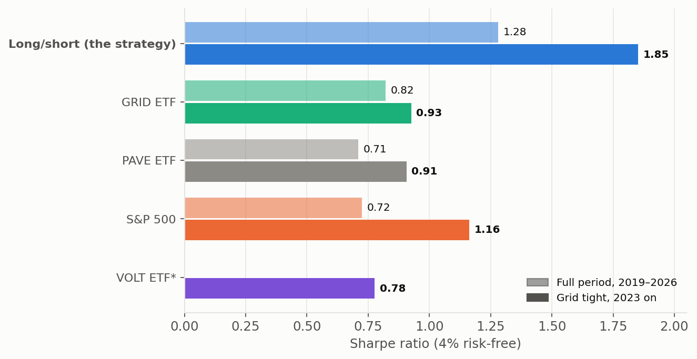</td><td style="width:50%;vertical-align:top;padding:2px">
Candidate (one score)
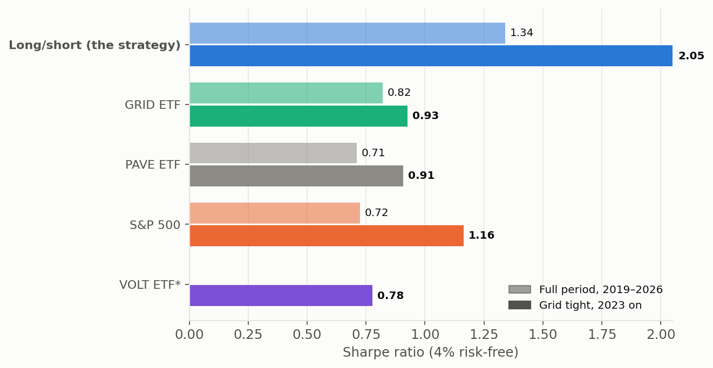</td></tr></table>
###### Rolling 12-month Sharpe

<table style="border-collapse:collapse;width:100%"><tr><td style="width:50%;vertical-align:top;padding:2px">
Current
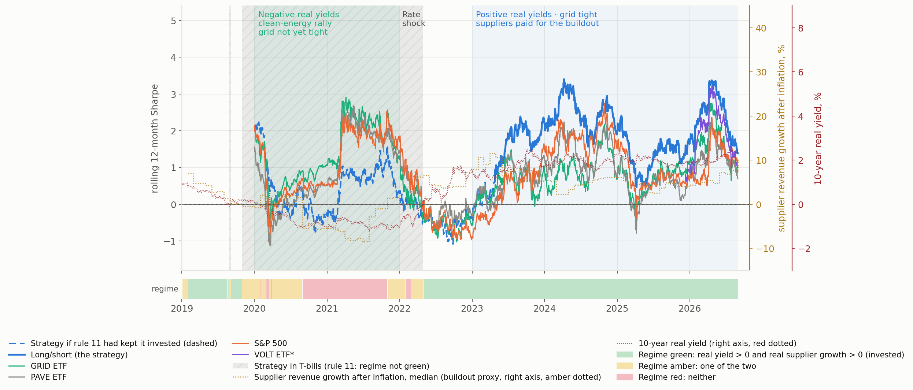</td><td style="width:50%;vertical-align:top;padding:2px">
Candidate (one score)
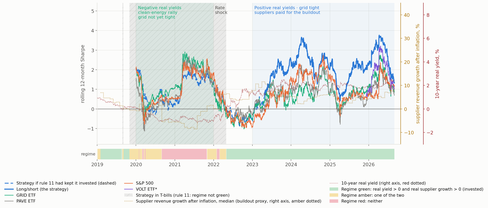</td></tr></table>
###### Growth of $1

<table style="border-collapse:collapse;width:100%"><tr><td style="width:50%;vertical-align:top;padding:2px">
Current
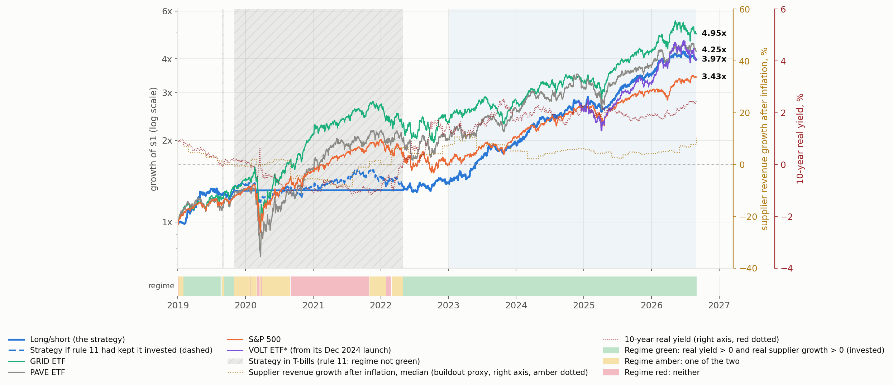</td><td style="width:50%;vertical-align:top;padding:2px">
Candidate (one score)
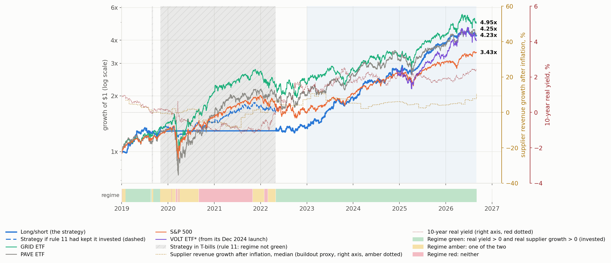</td></tr></table>

---

#### Portfolio Construction

Only the long book's RANK stage differs: **current** = capital intensity + revenue acceleration; **candidate** = the short's 14-signal score (6 from filings, 2 from prices, 6 from power markets).

###### Drawdown Reduction by Control

**2023 – Aug 2026** (long book alone, before the short, stepping aside and trading costs)

| cumulative controls | Sharpe, current | Sharpe, candidate | return, current | return, candidate | worst drawdown, current | worst drawdown, candidate |
|---|---|---|---|---|---|---|
| *Selected names, no risk control* | 1.52 | **1.59** | 51.5% | **57.9%** | **−27.9%** | −30.9% |
| *+ volatility target* | 1.58 | **1.72** | 42.9% | **47.7%** | **−21.4%** | −21.6% |
| *+ stretch de-lever* | 1.64 | **1.84** | 38.9% | **42.2%** | −21.4% | **−21.0%** |
| *+ gold/Treasury sleeve (the long book)* | 1.72 | **1.91** | 35.4% | **38.1%** | −17.7% | **−17.3%** |

**Full period, Jan 2019 – Aug 2026** (long book alone, before the short, stepping aside and trading costs)

| cumulative controls | Sharpe, current | Sharpe, candidate | return, current | return, candidate | worst drawdown, current | worst drawdown, candidate |
|---|---|---|---|---|---|---|
| *Selected names, no risk control* | 1.00 | **1.07** | 33.6% | **38.1%** | **−47.3%** | −48.9% |
| *+ volatility target* | 1.05 | **1.27** | 27.5% | **33.7%** | −28.8% | **−24.8%** |
| *+ stretch de-lever* | 1.04 | **1.27** | 25.2% | **30.4%** | −28.8% | **−24.8%** |
| *+ gold/Treasury sleeve (the long book)* | 1.08 | **1.31** | 23.1% | **27.3%** | −24.1% | **−20.8%** |

<table style="border-collapse:collapse;width:100%"><tr><td style="width:50%;vertical-align:top;padding:2px">
Current
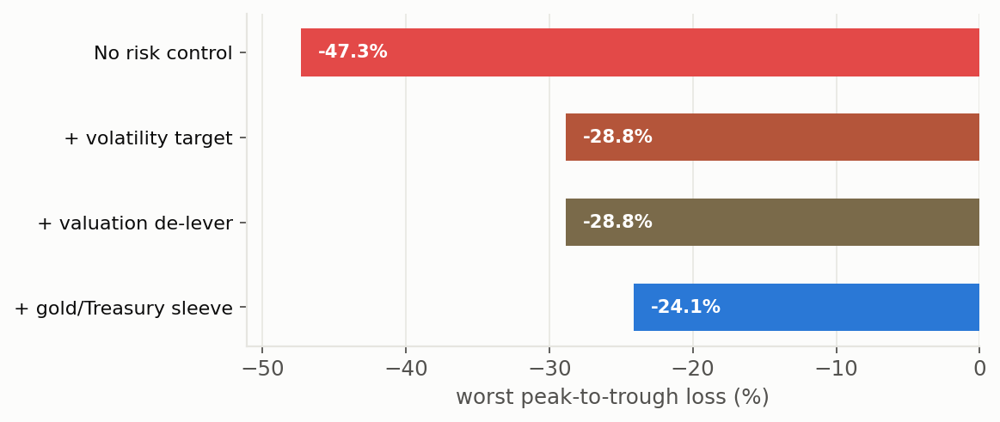</td><td style="width:50%;vertical-align:top;padding:2px">
Candidate (one score)
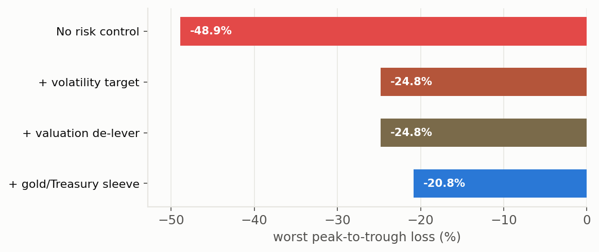</td></tr></table>

###### Short Book and Step-Aside Contribution

**2023 – Aug 2026**

| cumulative | Sharpe, current | Sharpe, candidate | worst drawdown, current | worst drawdown, candidate | beta, current | beta, candidate |
|---|---|---|---|---|---|---|
| *Long book, always invested* | 1.70 | 1.87 | −18.8% | −17.2% | 0.79 | 0.76 |
| *+ short side* | 1.85 | 2.05 | −11.9% | −10.2% | 0.56 | 0.54 |
| *+ stepping aside (the strategy)* | 1.85 | 2.05 | −11.9% | −10.2% | 0.56 | 0.54 |

**Full period, Jan 2019 – Aug 2026**

| cumulative | Sharpe, current | Sharpe, candidate | worst drawdown, current | worst drawdown, candidate | beta, current | beta, candidate |
|---|---|---|---|---|---|---|
| *Long book, always invested* | 1.07 | 1.26 | −26.3% | −23.2% | 0.64 | 0.64 |
| *+ short side* | 1.13 | 1.38 | −15.9% | −13.9% | 0.40 | 0.40 |
| *+ stepping aside (the strategy)* | 1.28 | 1.34 | −11.9% | −11.1% | 0.25 | 0.24 |

*After trading costs and borrow. Note the full-period last two rows: for the candidate, stepping aside **lowers** Sharpe (1.38 → 1.34), because its long book did best in 2020–21, the years the rule spent in T-bills.*

---

#### Performance History

##### Annual Returns

| | 2019 | 2020 | 2021 | 2022 | 2023 | 2024 | 2025 | 2026 YTD |
|---|---|---|---|---|---|---|---|---|
| *Strategy, current* | 30.3% | 0.4% | 0.1% | 7.0% | 40.9% | 34.1% | 30.9% | 14.8% |
| *Strategy, candidate* | 28.9% | 0.4% | 0.1% | 4.5% | 45.1% | 38.2% | 40.6% | 11.0% |
| *Always invested, current* | 40.9% | −0.4% | 7.8% | −1.4% | 40.9% | 34.1% | 30.9% | 14.8% |
| *Always invested, candidate* | 40.3% | 7.8% | 22.3% | −4.2% | 45.1% | 38.2% | 40.6% | 11.0% |
| *Sharpe, current* | 1.67 | *T-bills* | *T-bills* | 0.32 | 2.28 | 1.92 | 1.67 | 1.35 |
| *Sharpe, candidate* | 1.55 | *T-bills* | *T-bills* | 0.10 | 2.50 | 2.04 | 2.24 | 1.02 |
| *Worst drawdown, current* | −9.0% | −0.0% | 0.0% | −7.4% | −8.1% | −6.2% | −11.9% | −7.3% |
| *Worst drawdown, candidate* | −11.1% | −0.0% | 0.0% | −7.9% | −8.6% | −5.5% | −10.2% | −7.4% |

*The candidate is ahead in 2023, 2024 and 2025 (by 4, 4 and 10 points) and behind in 2019, 2022 and 2026 YTD. Always invested, it would have made 7.8% and 22.3% in 2020–21 against −0.4% and 7.8% for the current book.*

<table style="border-collapse:collapse;width:100%"><tr><td style="width:50%;vertical-align:top;padding:2px">
Current
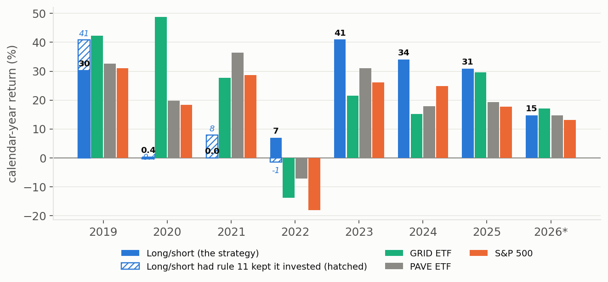</td><td style="width:50%;vertical-align:top;padding:2px">
Candidate (one score)
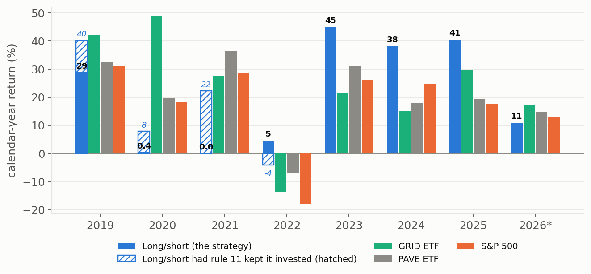</td></tr></table>

##### Drawdowns

<table style="border-collapse:collapse;width:100%"><tr><td style="width:50%;vertical-align:top;padding:2px">
Current
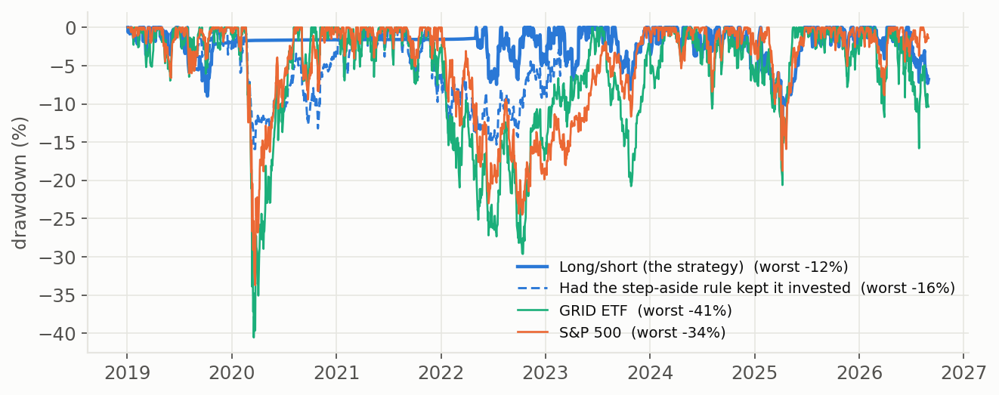</td><td style="width:50%;vertical-align:top;padding:2px">
Candidate (one score)
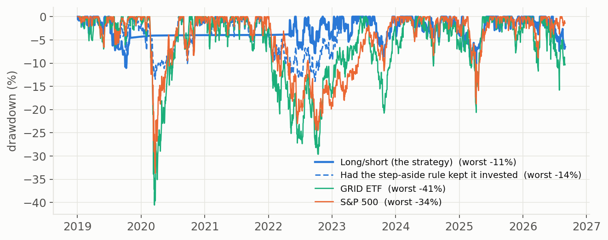</td></tr></table>

---

#### Step-Aside Rule

| | Sharpe full, current | Sharpe full, candidate | Sharpe 2019–22, current | Sharpe 2019–22, candidate | max drawdown full, current | max drawdown full, candidate |
|---|---|---|---|---|---|---|
| *Both conditions (the strategy)* | 1.28 | 1.34 | 0.55 | 0.44 | −11.9% | −11.1% |
| *Real yield alone* | 1.27 | 1.30 | 0.55 | 0.39 | −11.9% | −11.1% |
| *Always invested* | 1.13 | 1.38 | 0.49 | 0.79 | −15.9% | −13.9% |

*2023-on figures are identical across the three rows for each ranking (the rule has not fired since spring 2022). For the candidate, **always invested is the best full-period version** (Sharpe 1.38): the step-aside rule was tuned on the current ranking and costs the candidate return.*

---

#### Return Attribution

| 2023 – Aug 2026 | alpha a year, current | t, current | alpha a year, candidate | t, candidate |
|---|---|---|---|---|
| *Long/short vs GRID* | 18.7% | 3.50 | **21.7%** | **3.86** |
| *Long/short vs S&P 500* | 17.5% | 2.95 | **20.8%** | **3.37** |
| *Ranking alone: top half vs all qualifying names, equally weighted* | 3.9% | 1.64 | **7.1%** | **2.70** |

##### Style Factors

| 2023 – Aug 2026, controlling for | alpha, current | t, current | alpha, candidate | t, candidate |
|---|---|---|---|---|
| *GRID only* | 18.7% | 3.62 | 21.7% | 4.11 |
| *Academic factors* | 16.2% | 3.20 | 19.0% | 3.64 |
| *Academic factors + GRID* | 16.2% | 3.38 | 18.9% | 3.84 |
| *ETF style factors + GRID* | 19.9% | 4.06 | 23.0% | 4.60 |

Momentum loading (academic factors + GRID): current 0.24, candidate 0.23. R²: 0.57 vs 0.54.

###### Momentum Sell-Offs

| period | strategy, current | strategy, candidate | always invested, current | always invested, candidate |
|---|---|---|---|---|
| 27 Aug – 16 Sep 2019 | 0.7% | 0.2% | 3.2% | 3.3% |
| 9 Oct – 8 Nov 2019 | 6.9% | 6.8% | 11.6% | 11.8% |
| 16 Apr – 8 Jun 2020 | *in T-bills* | *in T-bills* | 2.5% | 0.8% |
| 14 Oct – 24 Nov 2020 | *in T-bills* | *in T-bills* | 5.2% | 6.1% |
| 12 Feb – 29 Mar 2021 | *in T-bills* | *in T-bills* | 3.5% | 5.6% |
| 14 Jun – 10 Aug 2022 | 2.3% | 1.9% | 2.3% | 1.9% |
| 27 Dec 2022 – 2 Feb 2023 | 4.3% | 7.6% | 4.3% | 7.6% |
| 12 May – 16 Jun 2023 | 8.2% | 9.1% | 8.2% | 9.1% |
| 10 Jul – 5 Aug 2024 | −0.0% | −1.4% | −0.0% | −1.4% |
| 27 Jan 2025 (DeepSeek) | −5.0% | −5.6% | −5.0% | −5.6% |
| 7 Feb – 10 Mar 2025 | −5.4% | −6.2% | −5.4% | −6.2% |
| 22 Jun – 31 Aug 2026 *(ongoing)* | −6.8% | −6.5% | −6.8% | −6.5% |

*Since 2023 the candidate did better in the two rebound-driven sell-offs (Dec 2022–Feb 2023, May–Jun 2023) and slightly worse in three of the four falling-market ones (Jul 2024, DeepSeek, Feb–Mar 2025).*

---

#### Short Book Detail

The short basket is the same rule in both. The only difference is which names are excluded because the long book holds them (today the candidate's basket has RRX in place of POR).

| shorted stocks | return a year, current | return a year, candidate | worst fall, current | worst fall, candidate |
|---|---|---|---|---|
| *Full period* | 7.2% | 6.4% | −46.8% | −46.8% |
| *2023 on* | 7.2% | 6.6% | −33.8% | −34.1% |

###### Rationale for the Short

| 2023 – Aug 2026, average month | long book − 0.25 × shorted stocks, current | candidate | long book beat shorted stocks by, current | candidate | GRID |
|---|---|---|---|---|---|
| *GRID down (17 months)* | −0.1% | 0.1% | 3.1% | 3.5% | −3.8% |
| *GRID up (27 months)* | 4.2% | 4.4% | 1.2% | 1.4% | 5.5% |
| *All months (44)* | 2.5% | 2.7% | 1.9% | 2.2% | 1.9% |

*Recomputed on identical code for both rankings; the current column can differ from the write-up by 0.1 in the last digit (rounding).*

<table style="border-collapse:collapse;width:100%"><tr><td style="width:50%;vertical-align:top;padding:2px">
Current
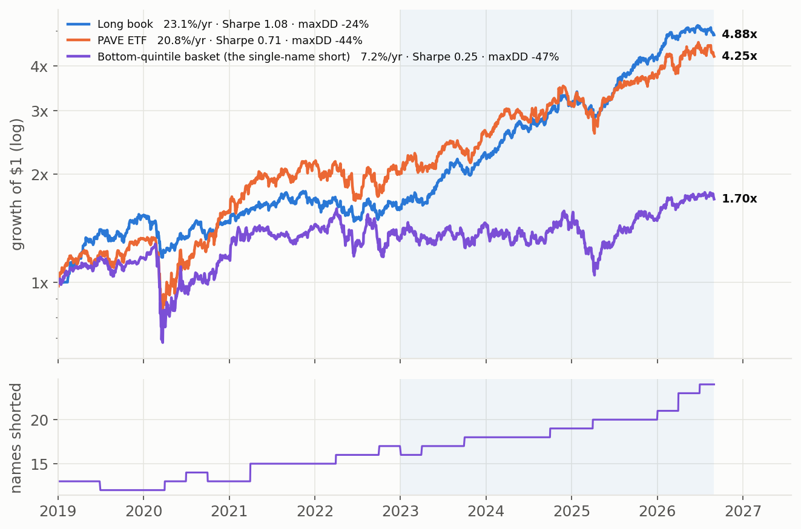</td><td style="width:50%;vertical-align:top;padding:2px">
Candidate (one score)
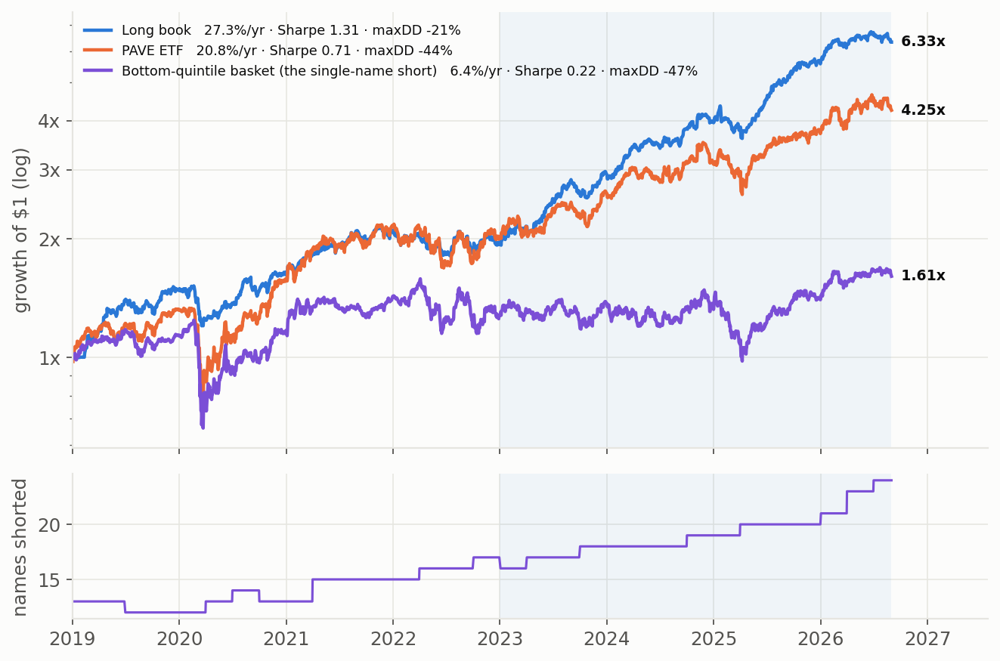</td></tr></table>

##### PAVE Alternative

| $0.25 PAVE short instead of single names | current | candidate |
|---|---|---|
| *Sharpe, full / 2023 on* | 1.20 / 1.79 | **1.24 / 2.00** |
| *Worst drawdown, full* | −13.4% | **−11.7%** |

---

#### Current Holdings

| long book, 11 Aug 2026 | names |
|---|---|
| *In both (13)* | BWXT · DY · ETN · FIX · KEYS · MIR · MKSI · MOG-A · MYRG · NVT · WCC · WTS · WWD |
| *Current only* | FELE · HUBB · PWR · RRX |
| *Candidate only* | AZZ · CW · POWL · VRT |

<table style="border-collapse:collapse;width:100%"><tr><td style="width:50%;vertical-align:top;padding:2px">
Current
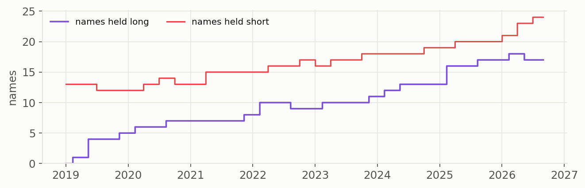</td><td style="width:50%;vertical-align:top;padding:2px">
Candidate (one score)
</td></tr></table>

---

#### Running Costs

| trading cost per trade | return, current | Sharpe, current | return, candidate | Sharpe, candidate |
|---|---|---|---|---|
| *None (before trading costs)* | 20.3% | 1.32 | 21.3% | 1.38 |
| *2bp* | 20.2% | 1.31 | 21.2% | 1.37 |
| *10bp (the figures on this page)* | 19.8% | 1.28 | 20.8% | 1.34 |
| *20bp* | 19.3% | 1.24 | 20.3% | 1.30 |
| *10bp + 1% management fee* | 19.0% | 1.22 | 20.0% | 1.28 |
| *10bp + 2% management fee* | 18.2% | 1.17 | 19.2% | 1.23 |

Turnover while invested, two-way: current 494%, candidate 505% (long name changes 103% vs 97%; long resizing 125% vs 138%).

*Full period. Borrow on the short (1% a year) charged in every row.*

